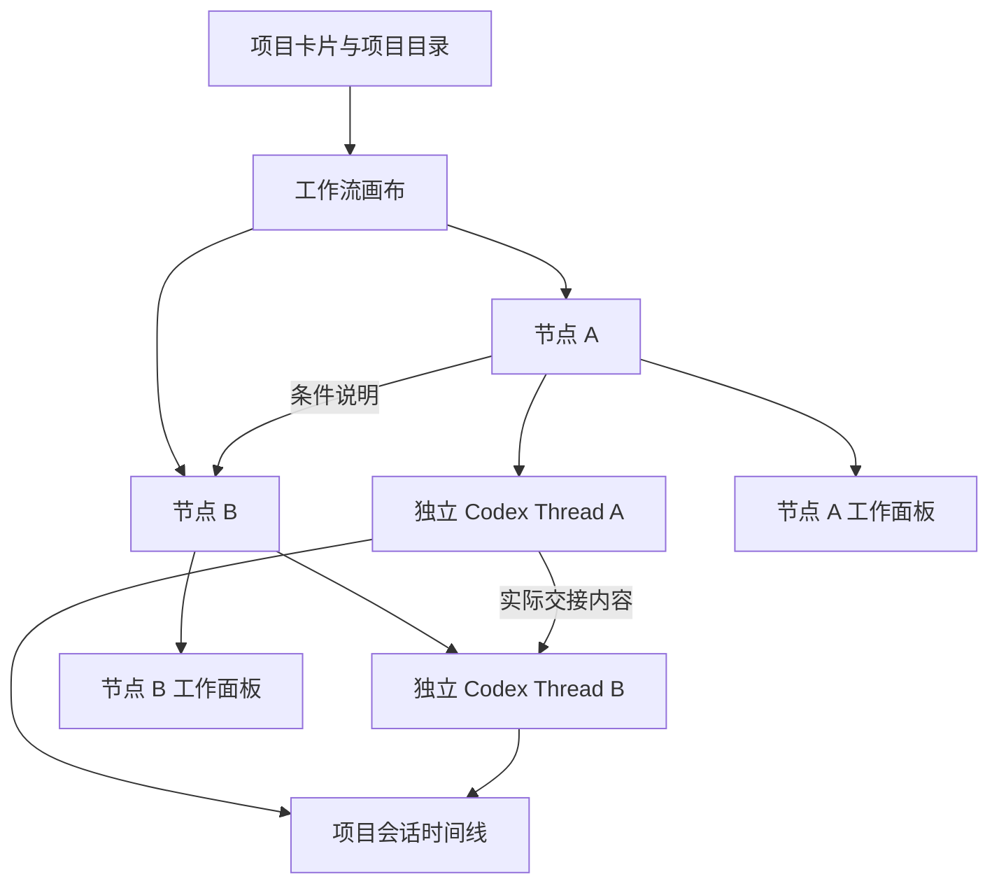
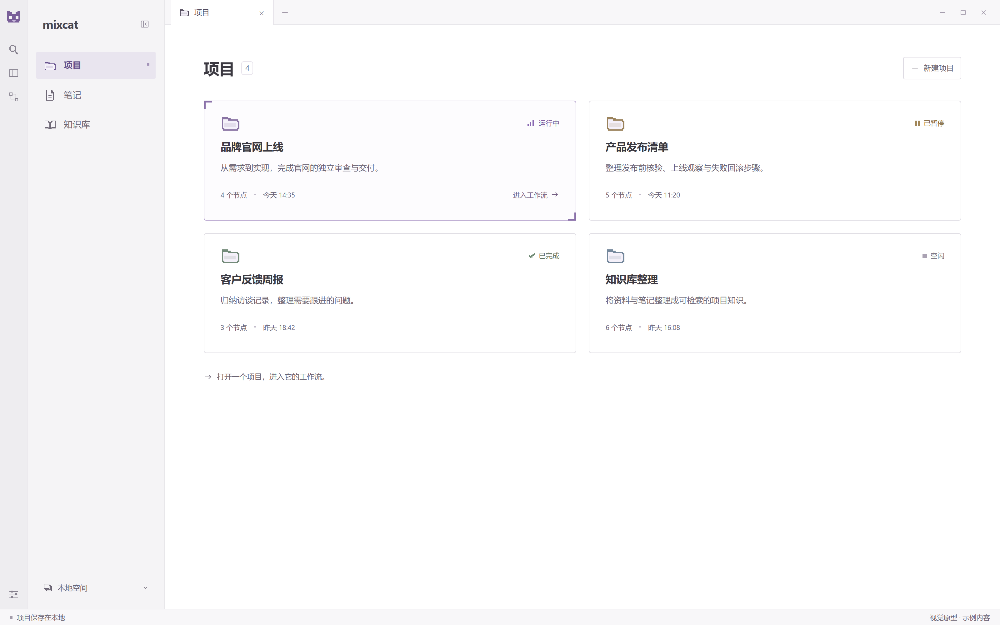
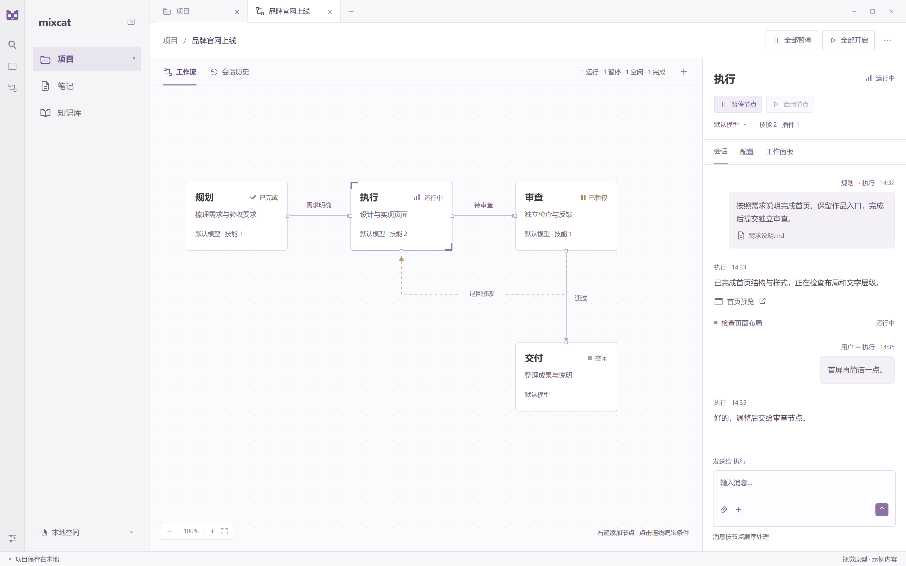

# Mixcat 客户端功能设计

日期：2026-10-19；修订：2026-10-21（UTC+08:00）

定位：正式客户端功能设计的统一入口。记录已确认的目标行为，并单独标识验证原型的观察与历史证据。  
归档位置：`docs/design/`，统一存放正式功能、架构及专项设计；视觉参考引用归档图片，可运行原型与实施计划另行存放。  
适用形态：独立桌面应用，在 Mixcat 内操作 Codex 原生会话。

**当前实现与验收见 [首阶段开发版需求矩阵](2026-10-20-delivery-status.md)。** 根目录正式实现的八项任务、必要修复复审及最终独立整体复核已通过。本文件保留目标行为、原型观察和待讨论接口。专项状态规则见 [节点状态与暂停覆盖](2026-10-19-node-controls.md)，会话扩展背景见 [会话节点工作台扩展](2026-10-19-session-workbench-design.md)。早期 [工作流设计](2026-10-19-mixcat-workflow-design.md) 和 [技术架构](2026-10-19-mixcat-technical-architecture.md) 保留决策背景；其中被后续需求覆盖的限制，不作为现行功能要求。

2026-10-20 的提交一致性、运行时并发、控制响应、来源记录、流式同步与原生适配修订见 [架构可靠性与边界修订](2026-10-20-architecture-hardening.md)。正式实施/回归证据由需求矩阵链接；原型历史测试不替代正式架构的实施验收。

2026-10-21 的 [MCP 协作设计](2026-10-21-mcp-collaboration-design.md)已实施；2026-10-24 的[动态条件边 MCP](2026-10-24-dynamic-edge-mcp.md)覆盖其中无连线发送与固定发送接口。当前按各节点出边生成可见工具，调用直接保存投递；下文旧接口和分阶段状态保留为历史记录。

正文的行为规则描述正式目标；下方原型观察与历史验证保留当时范围，不从历史原型能力推断完成。原型源码与运行入口归档至 `prototypes/desktop/`，静态界面图与渲染源归档至 `prototypes/ui/`；设计文档保留在 `docs/design/`，历史计划在 `docs/plans/`，真实项目数据和登录材料不随原型归档搬迁。

本文使用以下状态标记：

| 标记 | 含义 |
| --- | --- |
| 原型已有 | 验证原型已演示或已有对应代码；历史验证层级见第 14 节，不表示正式产品已交付。 |
| 原型部分具备 | 原型中已有基础能力，完整产品目标仍存在明确缺口。 |
| 已确认、待实现 | 用户要求已明确，仍需后续实施与验收。 |
| 待讨论 | 用户明确留到后续确定，不在本文代为冻结接口或执行语义。 |
| 暂不纳入 | 本轮不实现，保留原始方向说明。 |

## 1. 产品目标与范围

Mixcat 面向 OPC（一人公司）工作台，以项目卡片为入口，把多个独立 Codex 会话组织成可编辑、可交接、可回流的工作流。用户既能直接与任意节点交流，也能让 Agent 根据任务和协作者职责自主交接。

需要同时支持三种工作方式：

1. **直接会话**：用户选择节点，发送内容，节点使用自己的模型、上下文和工具完成工作。
2. **节点协作**：一个节点把成果和下一步要求交给另一个节点，接收节点继续处理。
3. **审查与回流**：项目需要审查时，由承担审查职责的节点提出问题，交回执行节点修改，之后再次审查。审查不是所有工作流的默认必经步骤。

客户端负责组织会话、保存输入输出、展示实际进度、管理运行状态和工作面板。执行与原生上下文由 Codex 会话引擎承担。

边界：

- 保留独立 Mixcat 应用，当前不要求会话能在官方 Codex 客户端中直接打开并继续。
- codex-console 仅是早期接入参考，不是产品依赖。
- ComfyUI 暂不纳入。本项目仍有未来支持其他项目卡片类型和执行能力的扩展方向，但当前没有交付通用类型注册框架或插件市场。
- 不把演练脚本的固定路线作为真实 Agent 的生产路线。
- 不将“执行成功”直接解释为“业务结论正确”或“项目目标已经通过独立验收”。

## 2. 已确认需求对照

| 编号 | 用户要求 | 原型观察与设计约定 | 详细位置 |
| --- | --- | --- | --- |
| 1 | 右键画布新增节点 | 原型已有，打开创建表单，在指定画布位置创建。 | 第 4、5 节 |
| 2 | 右键节点新增关联节点 | 原型已有，创建新节点并保存从当前节点指向新节点的关联边。 | 第 5、6 节 |
| 3 | 创建时指定模型、名称、插件和 skill，并可选择 | 原型已有；模型允许选择原生默认值，能力候选来自实际目录，本机插件可按选择导入项目。 | 第 5 节 |
| 4 | MCP 工具定义稍后讨论 | 按动态条件边设计生成来源节点可见工具，保留可配置的查询、历史、工作流编辑和人工核对工具。 | 第 10、15 节 |
| 5 | 关联边可配置条件，之后由 MCP 指导条件选择 | 条件编辑和持久化已有实现；出边动态生成工具，Agent 根据描述选择，调用直接沿绑定目标投递。 | 第 6、10 节 |
| 6 | 每个节点工作目录就是所属项目目录 | 原型已有，创建和恢复会话均使用项目根目录。 | 第 3、5 节 |
| 7 | 用户可向任意节点发送任意内容 | 原型已有自由文本与原生支持的附件；忙碌节点排队，暂停节点接收但不自动启用。 | 第 8 节 |
| 8 | 每个节点保存自己的上下文历史 | 原型已有独立 thread、会话复用、原始条目持久化及历史补齐。 | 第 8、9 节 |
| 9 | 查看整个项目按时间排列、注明节点归属的历史 | 原型已有项目时间线；不伪造缺失的原始时间。 | 第 9 节 |
| 10 | 保留 Codex 原生能力，只增加客户端协作能力 | 原型已移除旧 MVP 的强制只读、自动拒绝审批和强制正式交接；保留原生权限交互。完整宿主能力仍有第 11 项缺口。 | 第 11 节 |
| 11 | 展示当前工作，并保留浏览器、设计图等侧栏能力 | 原型已有当前工作展示和节点工作面板；Agent 浏览器控制桥、MCP App UI 双向桥已确认但待实现。 | 第 9、11 节 |
| 12 | 输入在右、输出在左，明确输入来源及正文 | 原型已有，用户输入与节点交接都保留来源；当前节点回复和工具活动在左侧。 | 第 8、9 节 |
| 13 | 输入输出内容由用户决定，不施加业务格式限制 | 普通会话自由内容已有正式实现，不要求固定 summary、verdict 或业务 Schema；新版 MCP 保持自由业务内容，调用信封方案已确认、待实现。 | 第 8、10 节 |
| 后续确认 | 全局与单节点暂停/开启覆盖同一份节点状态 | 原型已有；每节点一份多值状态，全局操作限当前项目，恢复范围不构成第二层锁。 | 第 7 节 |

“自由内容”表示客户端不强制业务字段、结论格式或固定流程；实际传输仍使用 Codex 支持的原生输入类型，并遵守身份、路径、协议及资源处理边界。

## 3. 核心对象与关系

| 对象 | 作用 |
| --- | --- |
| 项目 | 保存名称、目标、根目录、节点、关联关系、任务、历史和本地运行数据。 |
| 项目卡片 | 项目入口，展示名称、目标、目录、汇总状态和更新时间。 |
| 节点 | 一个有名称、职责、模型、可选技能和插件的会话工作位置。每个节点各自有一份权威状态。 |
| 原生会话 Thread | 节点自己的上下文载体，通过 threadId 与节点绑定。 |
| 任务 Task | 节点当前需要处理的一份输入及其执行记录。普通消息或节点交接都可产生任务。 |
| 原生轮次 Turn | Codex 的一次实际执行。暂停后续接会在原 thread 中产生新 turn。 |
| 会话条目 | 原始输入、回复或执行事件，关联项目、节点、任务、thread、turn、来源和时间。 |
| 关联边 | 用户配置的有向关系及条件说明，描述希望怎样协作。 |
| 交接记录 | 实际发生的一次成果提交与投递，记录来源、目标、内容、原因及状态。 |
| 协作消息（已确认、待实现） | 一次独立发送及其目标任务，保存原始内容、来源、选路依据和可选回复关联；发送不结束来源工作。 |
| 工作面板 | 属于某个节点的网页或文件/产物展示区域。 |
| 暂停恢复名单 | 批量暂停时记录的执行节点范围，仅用于决定批量续接对象。 |

关系规则：

- 每个节点复用自己的原生会话，普通新消息和返工不自动清空上下文。
- 当前同一节点串行处理任务，不在同一个 thread 上并行启动两个 turn；不同节点可以各自执行。
- 多个节点共享所属项目目录。当前没有为每个节点建立独立工作树，也没有自动合并同时发生的文件修改。
- 节点上下文与输入传递分别保存：下游得到明确交接的内容，来源节点的完整聊天不会自动复制给下游。
- 条件边与交接记录是不同对象，不能用一次历史交接反推未来必须遵守的条件边。

## 4. 页面与入口

### 4.1 项目列表

当前提供创建、打开项目及进入演练项目的入口。创建项目填写名称、项目目标和已有的项目目录；点击卡片进入该项目工作流。

项目目录同时决定节点工作目录及项目数据归属。现有记录按目录恢复，不能悄悄把另一个目录中的会话当作当前项目。项目删除、归档、跨目录搬迁和项目类型切换没有在当前版本提供正式交互。

当前正式导航为左侧“项目／笔记／知识库”，项目卡片在中间展示，点击卡片进入工作流。“设置”入口位于最左侧窄栏的左下角，使用齿轮图标，点击后显示选中状态。设置统一管理整个客户端共用的 Codex 账号，节点详情不再提供单独登录；没有项目时也可登录。笔记编辑与知识库尚未实现，其实体、来源引用和所属目录约定见 [架构修订第 8.4 节](2026-10-20-architecture-hardening.md#84-项目笔记与知识库)。

节点右键及详情均可删除节点，确认后移除活动节点及配置关联边，保留历史、任务和原生会话绑定；未完成任务需先处理，历史中标记已移除节点。共享账号的数据归属、归档式删除和并发规则见[设置、共享账号与节点删除](2026-10-20-settings-and-node-deletion.md)。

### 4.2 项目工作台

工作台由以下部分组成：

| 区域 | 内容与操作 |
| --- | --- |
| 项目栏 | 左侧为项目名称、目录和汇总状态；中间为项目状态栏；右侧为项目历史、全部暂停、全部开启、停止本轮。 |
| 项目状态栏 | 位于项目栏中间，集中展示工作流会话数量、运行/启动/暂停/等待续接/排队/需处理/空闲/完成数量，以及“添加节点”；不再占用画布上方两行。 |
| 工作流画布 | 白色背景，无点阵底纹；展示节点卡片、配置的关联边、实际交接路线、缩放及定位。 |
| 节点详情 | 所选节点的名称、状态和单节点暂停/启用、删除；工作目录保留在项目栏展示。 |
| 会话页 | 输入输出、原生工作记录、当前活动和需要用户回应的请求。 |
| 配置页 | 名称、职责、模型、技能和插件选择。 |
| 工作面板页 | 当前节点的网页及文件/产物面板。 |
| 消息输入区 | 向所选节点发送文字、添加附件，显示排队或暂停提示。 |

节点切换改变当前查看和发送的目标，不重建该节点会话。已有上下文、任务和面板归属保持在原节点。

侧边栏右侧的项目工作区统一使用白色布局底色，包括项目栏、目标区、画布、节点详情、输入区及底部活动区；状态颜色、选中描边和消息内容继续保留语义。项目状态栏在较窄窗口内允许内部换行，不能与项目名称或右侧运行操作重叠。

### 4.3 画布操作

- 空白处右键进入“新增节点”；顶部“添加节点”提供同等入口。
- 节点上右键进入“新增关联节点”或该节点配置。
- 点击节点打开对应会话详情；拖动只调整布局。
- 拖动正在运行、暂停或排队的节点不会变更配置版本、会话绑定或 MCP 身份。
- 配置更新保留当前布局，避免 Agent 持有的旧坐标覆盖用户刚完成的拖动。
- 点击关联边选择连线并显示端点与中间线段控件；点击条件文字或双击连线继续编辑条件。
- 端点可拖到原节点的任意一侧，靠近边缘自动吸附，邻近四分之一、中点和四分之三位置时吸附到对应连接点；拖到其他节点或远离原节点后松开则取消，不改变节点之间的业务关系。
- 拖动中间的水平或垂直线段调整走线，按 10 个画布单位吸附，保持直角折线与节点连接。端点和线段控件支持方向键微调，Esc 取消当前拖动。
- 连线布局独立保存端点、折点和布局版本，不改变条件边版本、MCP 路由、节点能力及会话状态。重载或重新打开项目保留布局，移动节点继续保持端点连接；无历史布局数据时自动生成路线。保存失败恢复已保存布局并显示错误。
- 菜单提供键盘可达入口，弹窗和菜单显示时隐藏覆盖在其上的原生网页视图。

### 4.4 界面视觉参考：极简布局与像素元素

以下两张图片记录当前确认的视觉方向：采用类似 Obsidian 的侧栏与内容区布局，在标识、图标、状态和选中折角中加入克制的像素元素，正文保持清晰易读。图片中的项目、节点、状态和消息均为示例，不表示正式功能已经实现。

**项目页。** 左侧固定“项目／笔记／知识库”导航，选择“项目”后在中间展示项目卡片；点击项目卡片进入对应工作流。

**工作流页。** 中间展示节点、条件边及回流路线，右侧展示所选节点的会话、配置和工作面板入口。输入靠右、输出靠左，并标注输入来自用户还是其他节点；项目级与单节点运行控制保持可见。图中的角色组合与路线仅作示例。

图片原件及静态页面统一保存在 [界面原型归档](../../prototypes/ui/README.md)，本节直接引用归档图片。

## 5. 节点创建、模型与能力配置

### 5.1 创建表单

| 字段 | 设计约定 |
| --- | --- |
| 节点名称 | 用户指定，作为画布、会话和历史归属标签。 |
| 职责与指令 | 描述该会话负责的工作；用户可修改，不强制采用规划/执行/审查角色。 |
| 模型 | 选择原生目录中返回的模型，或明确使用原生默认模型。 |
| Skills | 可搜索、勾选实际发现的技能。 |
| 插件 | 可选择项目中可用的插件，以及可从本机已安装包导入的候选。 |
| 关联条件 | 从已有节点创建新节点时提供，说明从来源到新节点的协作条件。 |

新节点创建时保存配置和初始位置；通过“新增关联节点”创建时，节点与关联边一起保存，避免只创建其中一半。

### 5.2 能力来源与生效

- 模型和技能候选读取实际 Codex 能力目录，不在界面伪造可用模型或工具。
- 某一目录读取失败时显示该来源的失败信息；不把读取失败解释为“没有能力”。
- 选中技能作为原生 skill 输入传入；选中插件作为原生 plugin mention 使用。
- 本机插件尚未安装到项目时，按用户选择导入该包到项目内，再通过原生插件安装接口接入。
- 不复制宿主账号凭据，不批量导入未选择插件；插件依赖的外部账号或宿主服务需另外满足。
- 选择技能和插件表示本节点的激活偏好，不把未选择的原生能力改成禁用白名单。

### 5.3 修改与执行的关系

当前节点存在运行、已暂停未完成、排队、等待来源或待核对任务时，配置页会说明原因并暂时禁用保存；用户仍可编辑草稿或移动节点。这样正在执行或准备续接的任务不会悄悄换成另一份配置。

任务处理完后，配置保存产生新版本。模型、职责或能力变更用于后续执行，继续保留节点原有 thread。保存时检查配置版本，避免覆盖其他用户操作或 Agent 刚完成的修改。

工作目录不作为每个节点任意改写的配置项：节点启动和恢复都使用当前项目根目录。

## 6. 关联条件、交接路线与工作流编辑

### 6.1 两种线分别表达什么

| 线的类型 | 来源 | 当前作用 |
| --- | --- | --- |
| 配置的关联边 | 用户新增关联节点、编辑条件 | 保存来源、目标和自然语言条件，表达预期协作关系。 |
| 实际交接线 | 后台持久化的 handoff 记录 | 展示已经发生的方向、次数及回流。 |

关联边条件可以为空，之后补充；可以编辑或移除关联。删除关联边不会删除节点或抹去已经发生的交接历史。

条件示例：“成果需要独立检查时交给审查节点”“需要补充证据时交给验证节点”。这些是用户提供的自然语言说明，当前没有表达式解释器，也没有自动判断真假的规则引擎。

### 6.2 已确认、待实现的条件执行语义

目前条件已保存，但现有 MCP 项目查询尚未向 Agent 提供这些关联边；不能据此宣称模型已按条件路由。2026-10-21 已确认以下方案，书面规格见 [MCP 协作设计](2026-10-21-mcp-collaboration-design.md)，尚未接入运行：

- `get_project_context` 提供节点职责、能力、当前状态及相关自然语言条件边和版本；完整会话记录通过 `read_history` 按需查询。
- 条件边按[动态条件边 MCP](2026-10-24-dynamic-edge-mcp.md)生成来源节点可见的工具，目标由工具绑定；每次发送记录选择理由。自然语言是否满足由 Agent 判断，调用后直接保存投递，不重复核对路径。
- 每次发送一个目标，需要多个协作者时分别发送；不在本版自动汇合多个结果。
- 条件边工具自动绑定边快照并记录发送理由，无需 Agent 再提供目标和边版本。已受理消息保留发送时依据，后续编辑不改写历史，也不二次核对路径。
- 信息不足或没有合适目标时，Agent 可继续收集信息、按现有授权调整工作流或报告缺口，不虚构条件已满足；用户明确提出的任务要求仍应遵守。

这些规则约束协作信封与可追溯性，不限制用户的业务内容格式，也不把历史路线变成固定执行顺序。

### 6.3 人工与 Agent 编辑

用户可以编辑节点与条件边。具备现有流程修改工具的 Agent 已能查询节点、创建或更新节点定义；调用仍须通过身份、配置版本及执行状态检查。

新版 `update_workflow` 创建/修改节点及条件边的方案已确认、待实现，复用界面的身份、版本、执行状态校验与现有授权，不新增 Codex 原生能力限制。当前有“Agent 建节点”的兼容能力，不等同于完整条件工作流生成器已经完成。

## 7. 节点状态与运行控制

### 7.1 一份权威状态，多种取值

**每个节点各自保存一份 `status`。** 这不是全项目共用一个状态，也不是状态只有一个值。全局操作、单节点操作及原生执行事件共同更新这份状态。

不设置互相叠加的“全局暂停锁”和“单节点暂停锁”。项目状态只汇总节点情况；暂停恢复名单只记录批量续接范围，不构成额外的节点开关。四种用户操作在各自作用范围内覆盖前一次操作；尚未确认的原生结果不能因按钮点击而伪装成成功。

本版“全部/全局”的范围是**当前项目内的节点**，没有实现一次控制所有项目的跨项目总开关。

| 节点状态 | 显示含义 |
| --- | --- |
| `idle` | 空闲，可接收新消息或交接；没有正在执行的任务。 |
| `queued` | 有待处理工作，尚未进入实际运行；也可能在等待来源完成。 |
| `starting` | 已进入启动流程，尚未确认原生轮次开始。 |
| `running` | 当前原生轮次正在执行。 |
| `pausing` | 已请求暂停，仍在等待原生停止确认。 |
| `resuming` | 启用已覆盖暂停，正在等待旧轮次结束或准备续接。 |
| `paused` | 节点暂停，未完成任务和新消息保留。 |
| `blocked` | 执行失败、结果未知或其他情况需要处理，不能当作已成功暂停。 |
| `completed` | 已有任务完成，目前没有待执行工作；仍可接收后续输入。 |

运行数量只统计 `running`；启动中、暂停中、等待续接、排队和需处理分别统计。任务和原生轮次保留自己的执行记录，用于判断真实进度，不是给节点叠加第二层控制状态。

### 7.2 四种操作

| 操作 | 更新范围 | 行为 |
| --- | --- | --- |
| 全部暂停 | 当前项目节点 | 记录当时运行或启动中的节点，保存暂停状态，异步请求原生中断；保留未完成任务和队列。重复暂停不丢弃本批尚未恢复的执行。 |
| 全部开启 | 暂停恢复名单中的执行节点，以及没有未完成工作的待命节点 | 续接被记录的工作；无未完成工作的节点恢复空闲/完成，不生成任务。原先只排队、未运行的工作不被批量启动。 |
| 暂停节点 | 用户指定节点 | 直接修改该节点状态，也能覆盖刚发出的启用请求，不改变其他节点。 |
| 启用节点 | 用户指定节点 | 直接启用，不受项目暂停或恢复名单额外阻挡；有暂停任务先续接，有队列按序处理，无工作则待命。 |

`pauseSnapshot` 中的节点即使后来又被单独暂停，也可由全部开启覆盖。未列入批量恢复范围的待处理节点，用户可以直接单独启用。对未知执行仍保留“需处理”，不能靠批量操作盲目重放。

### 7.3 用户确认的行为例子

| 场景 | 必须得到的结果 |
| --- | --- |
| A 运行、B 空闲 → 全部暂停 → 全部开启 | A 继续；B 空闲，不凭空启动。B 今后收到新交接时正常处理。 |
| 全部暂停 → 单独启用 A | A 可以继续，其他节点保持各自状态。 |
| 单独暂停 A → 全部开启，A 在恢复名单中 | 全部开启覆盖 A 的单独暂停。 |
| 暂停 A → 中断尚未确认时启用 A | A 显示等待续接，不能并行发出第二个 turn。 |
| 上一步之后再次暂停 A | 最后一次暂停生效；中断确认后保持暂停。 |
| 节点只排队，暂停时未运行 → 全部开启 | 不因批量恢复被启动；用户可单独启用它。 |
| 暂停节点收到新消息 | 保存并排队，发送消息本身不隐式启用节点。 |
| 原生正常完成与暂停同时发生 | 以真实完成为准；之后开启不重放已经完成的工作。 |

### 7.4 暂停、续接与停止

Codex 当前没有冻结并恢复同一个 turn 的接口。客户端用 `turn/interrupt` 请求中断，收到匹配的 interrupted 完成事件后才确认暂停。启用保留原 task、thread 和上下文，在新 turn 中发送续接说明，不原样重发原始请求。

原始输入保留原来的正文、turn 关联和暂停历史；每次续接追加独立条目。旧 turn 的迟到事件不能结束新 turn。旧 `handoff` 已受理交接仍保留，来源续接成功后才放行一次，不重新创建同一份交接。新版普通消息已在受理后独立排队，不等待来源续接；暂停来源不会自动暂停目标节点。

“停止本轮”另有明确含义：取消未执行的任务并请求结束活动执行。它不等同于保留任务等待继续的暂停。断连、退出或中断结果不明时保留待核对状态；明确核对后重试保留独立记录，避免把不确定执行当作从未发生。

**待实施的控制响应设计：** 控制命令不应等待历史、能力目录或连接查询，也不被无关查询的忙碌标记禁用。普通修改的短状态更新按项目排序；停止取消此前尚未开始的新执行动作，异步等待结束后重新检查状态。桌面命令拟使用稳定编号，超时核对原动作，不盲目重发；详见 [控制响应与命令受理](2026-10-20-architecture-hardening.md#4-控制响应与命令受理)。

## 8. 自由输入、输出与队列

### 8.1 用户发送

用户可以选任意节点发送文字和原生支持的附件。普通消息不要求 summary、verdict、固定业务 JSON Schema，也不要求为了结束回复而调用交接工具。

消息在执行前保存原始输入与来源。同一节点忙碌时，后续消息按顺序排队；当前界面不把新消息默认插入或引导正在运行的 turn。不同节点可以处理各自任务。

用户选择的附件导入项目内后发送：图片、音频使用相应原生输入类型，其他文件提供项目内文件引用。是否能理解某种媒体仍取决于所选模型和原生能力，不由客户端伪造处理结果。

### 8.2 输入输出显示

| 类型 | 位置 | 必须展示的内容 |
| --- | --- | --- |
| 用户输入 | 右侧 | 用户来源、接收节点、正文或附件、时间。 |
| 节点交接输入 | 右侧 | 来源节点、接收节点、交接要求及实际传递内容。 |
| 系统续接输入 | 右侧 | 待实施：显示“系统续接”、接收节点和 Mixcat 生成正文，并关联触发控制；不能标成用户原话。 |
| 来源未知的原生输入 | 右侧 | 待实施：显示“原生输入（来源未知）”、接收节点与原文，不从 userMessage 角色推断作者。 |
| 当前节点回复 | 左侧 | 所属节点、实际输出内容、时间。 |
| 工具与执行事件 | 左侧 | 所属节点、事件内容、原生状态，必要时展开原始记录。 |

来源节点改名不能把旧交接的来源信息重写成另一段历史。输入中的要求、证据和字段不能被自动摘要替换；非字符串交接结果完整序列化，不能只抽取 summary 丢掉其他字段。

发送过程中新增的草稿不能被前一条请求的成功回执清掉。切换节点时，消息发送目标和当前草稿应明确对应该节点；不能把某个节点的输入误发给另一个节点。

## 9. 会话历史、项目时间线与当前工作

### 9.1 两种历史视图使用同一份记录

节点会话页筛选当前节点的条目；项目会话历史合并所有节点，显示节点归属、输入来源及时间。打开项目历史时补读有原生会话的节点，不要求用户先逐个进入节点。

保存的信息包括原始 native item、输入正文、来源、项目内序号、任务及 thread/turn/item 关联。当前不再将历史静默截断为最近 300 条活动。

### 9.2 时间、补齐与去重

- 已知时间按时间及稳定序号排列；没有原始条目时间时保留已知任务/轮次时间或标为未知，不伪造精确发生时刻。
- 缺少时间的历史只保证稳定呈现，不能声称已经恢复其真实时间位置。
- 原生历史以分页条目接口补齐，兼容会话读取方式。
- 同一个原生 item 的开始、增量、完成更新同一条记录，避免整段内容重复出现。
- 历史读取期间到达的新实时内容不能被较旧的历史响应覆盖；已完成内容不能倒退为半截运行中内容。
- 原生 userMessage 回传与预先保存的输入建立关联，不重复展示同一份输入。
- 原始记录和来源关联是依据，摘要或视图不能覆盖它们。

**待实施的来源与同步设计：** 迁移只修正可核实的作者标签，不改原文。关键输入、状态及交接持久化成功后才返回成功；纯流式文字拟短周期合并，完成与正常关闭时刷新，界面按条目增量更新。具体周期、数据库历史分表、分页和长期项目指标须后续测量与验收，不冻结原型临时参数，见 [历史与同步边界](2026-10-20-architecture-hardening.md#5-历史来源流式保存与视图同步)。

### 9.3 当前工作

界面展示当前节点的原生工作事件，包括工具开始/进度/完成、命令、文件修改、计划及可识别产物。不能只记录“调用了某工具”而永久保留执行中的观感。

当前活动必须匹配当前任务和当前 turn。旧轮次尚未补齐的工具记录仍可在历史查看，但不能冒充续接轮次正在执行的工作。未知原生条目保留原始内容，不因界面暂未支持专用展示而丢弃。

命令输出记录已经可以呈现；完整交互式终端不是当前已交付能力，不能用日志面板代称。

## 10. Agent 协作、独立审查与 MCP 边界

### 10.1 当前兼容能力

现有 MCP 提供项目/节点查询、交接、完成/阻塞报告及节点定义调整。Agent 根据节点职责自主选择目标，客户端验证来源身份并实际调度。

这些现有工具属于可运行的兼容基础。2026-10-21 新版协作方案已确认，书面规格已确认，实施计划待审阅、尚未实现。客户端已取消普通输入输出的业务 Schema 强制，但 MCP 调用仍需有合法目标、参数和会话身份。

现有 `handoff` 兼容交接时序如下，其提交与发布一致性已在首阶段实施，证据见 [交付矩阵](2026-10-20-delivery-status.md)。来源成功完成的门槛仅适用于这种兼容交接，不适用于第 10.3 节的新普通消息：

1. 来源节点提交目标、下一步要求、选择理由及交接成果。
2. 后台在候选状态准备成果引用、交接记录与接收任务，数据库提交成功后才发布并返回已受理；提交失败的候选不得参与调度或幂等成功判断。
3. 接收任务先等待来源轮次结束，不在工具调用中同步等待目标完成。
4. 来源原生轮次成功后，接收任务才可以进入目标节点队列。
5. 目标未暂停且可执行时启动；目标忙碌时排队，目标暂停时保留。

兼容协议中一次任务只接受一次正式终结交接或完成动作；相同已受理请求可返回原受理结果，不重复创建接收任务。旧 `handoff`、`complete_task` 保留兼容，普通自由回复不需要正式交接动作；这项终结次数约束不推广到新版普通消息发送。

### 10.2 回流与独立审查

审查节点发现问题后向执行节点再次交接，执行节点修改后再交审查。回流沿用原节点会话并增加任务/执行记录；不能因循环就清空上下文或隐去原始要求。

“规划 → 执行 → 审查 → 修改 → 复审”是可配置的协作示例。用户可以建立其他角色或更多审查节点；当前没有把这条路线硬编码为生产必经顺序，也没有交付自动多模型投票规则。

审查仅按用户配置或任务要求进行，没有审查要求时可以直接交付。没有审查节点不自动触发第二遍审查或强制新增节点；用户明确要求审查却没有承担者时，应解决职责缺口，不能声称已通过审查。独立审查可由具有相应职责的其他节点承担，不依赖节点名称。

独立会话、审查职责和工具证据有助于交叉检查，但客户端不自动证明语义正确。未验证、存在争议或需人工判断的事项应保留在成果中。

共享目录允许内容同时变化，因此审查结论需要关联确定的成果版本、文件内容摘要或已有提交，说明结论适用对象。新版协作消息的附件版本快照已纳入已确认、待实现方案；它不等于自动发现并行文件冲突、判定旧审查结论失效或自动发起复审，这些自动化仍待单独设计。不强制为非 Git 项目创建仓库或为每个节点另建工作目录。

### 10.3 已确认、待实现的 MCP 协作方案

五个核心工具为 `get_project_context`、`send_message`、`get_delivery`、`read_history`、`update_workflow`，分别用于环境查询、发送/回复、投递查询、历史读取和工作流编辑。方案已确认，书面规格已确认，实施计划待审阅；工具参数和验收契约集中记录在 [MCP 协作设计](2026-10-21-mcp-collaboration-design.md)，本次不修改代码。

普通发送将消息、目标任务与对应历史持久提交后进入目标队列，返回已受理不表示目标已执行完成。来源可继续工作，来源之后失败不会撤销或改写已经受理的发送。目标忙碌时排队，暂停时保留，不自动启用；投递查询关联现有任务状态，不新增节点控制开关。

节点通过显式 `reply_to` 回复；普通输出保存在当前节点，不自动跨节点广播。等待回复且无其他工作时结束当前原生 turn，保留原 thread；回复到达后按现有队列和节点状态启动下一轮，不把等待变成用户暂停。来源身份由宿主绑定，业务内容保留原文，不要求统一业务 Schema。

首版单次单目标，可多次发送；自动 join、自动文件冲突处理和审查结论失效仍不纳入本版。节点 cwd、原生能力和每节点唯一多值状态规则继续适用。

## 11. 原生能力、审批与工作面板

### 11.1 保留原生执行能力

客户端以增加协作能力为原则，不继续采用早期 MVP 中强制只读、所有审批自动拒绝、必须交接才能正常结束的限制。

当前原生会话请求 `workspace-write` 和 `on-request`。命令、文件、权限申请、用户问题及插件交互请求进入界面，按原生允许的回应选项返回；不把“保留能力”实现成无条件批准所有操作。

Windows 原生沙箱未配置时使用原生 unelevated 配置，使项目写入模式能够生效；已经配置的原生模式予以保留。实际回执被记录，若仍是只读要明确显示，不能仅凭请求参数宣称已经获得写入能力。

目录连接、登录状态与模型执行分别展示。账户路由查询超时时只重试账户查询一次，保留手动重试入口和登录数据，不因此重发任务。

**原型阶段的原生适配设计记录：** 记录实际二进制、可取得的版本及初始化环境，未知保持未知；按审批、问题、权限、插件表单／授权和宿主能力分类，在协议边界验证回应；未接入宿主请求明确说明不支持，不能让用户猜 JSON 冒充执行。成文时原型保留了部分原生交互，完整分类、兼容矩阵及插件业务验收尚待完成。

2026-10-20 首阶段已实现并复核本轮分类、后台回应校验及兼容矩阵；真实登录、模型和全部插件业务仍未验收，实际能力范围以[当前交付矩阵](2026-10-20-delivery-status.md)为准。

### 11.2 原型工作面板与目标缺口

| 能力 | 原型观察与目标缺口 |
| --- | --- |
| 节点归属的网页面板 | 原型已有真实 Electron 网页视图，用户可导航、前进后退、切换与关闭。 |
| 文件和产物预览 | 原型已有项目内文本、图片、PDF、HTML 及可支持资源的展示。 |
| 本地 HTML 设计图 | 原型已有本地页面及相关本地资源预览；依赖外部服务的设计可通过实际网页地址查看。 |
| 节点间面板切换 | 原型已有按项目与节点归属切换，旧节点隐藏请求不能覆盖新节点视图。 |
| Agent 操作内嵌浏览器 | 已确认、待实现控制工具桥。当前网页展示不等于 Agent 已能观察和操作该网页。 |
| MCP App UI | 已确认、待实现标准资源与双向交互桥。当前不能宣称完整插件设计编辑器已接通。 |
| 官方桌面全部宿主能力 | 未整体移植。能力需按实际引擎、插件与宿主适配分别接入和验收。 |

网页没有主应用 IPC 和 Node 权限；浏览器 profile、附件、下载及预览运行数据保存在所属项目内。打开弹窗、切换节点或回到项目列表时，面板显示状态要与当前界面一致。

### 11.3 插件可用性的判断

插件已在本机存在、已导入项目、原生能够发现、所需账号已授权、实际业务工具能够使用，是不同事实。界面与文档不能把其中一个事实当作全部完成；未装载或依赖其他宿主的能力不得标成已可用。

## 12. 本地数据、生命周期和异常恢复

### 12.1 保存位置

| 位置 | 内容 |
| --- | --- |
| 工作台 `.runtime/` | 开发缓存、工作台索引、桌面运行和验证证据。 |
| 项目 `.mixcat/state/workflow.sqlite` | 节点、配置版本、条件边、任务、权威状态、暂停恢复范围、会话条目和交接记录。 |
| 工作台 `.runtime/client/account/` | 客户端共用的原生账号登录与刷新，不执行项目会话。 |
| 项目 `.mixcat/codex/` | 项目原生会话及运行数据；共享账号通过临时 token 注入，旧登录文件原位保留。 |
| 项目 `.mixcat/artifacts/` | 已正式提交的成果文件。 |
| 项目 `.mixcat/attachments/` | 用户选择后导入的附件。 |
| 项目 `.mixcat/browser/`、`downloads/` | 浏览器 profile 和下载。 |
| 项目 `.mixcat/plugin-imports/` | 按用户选择导入的本机插件源。 |

项目生成的工作数据保存在各自所属项目内，不写入 C 盘或项目外目录。创建前校验实际路径和祖先目录，拒绝路径逃逸和目录联接；Codex 自身已有全局运行依赖按内部数据规则使用。

SQLite 事务保存兼容迁移；升级不能清空旧任务、成果、会话绑定或原文。当前 v1 数据可迁移至 v2，新增状态字段兼容已有项目。

当前工作台、Codex 和节点工具属于同一操作系统用户下的可信协作环境。路径与网页权限校验不等于 Agent shell 对控制数据库和登录材料的强隔离。正式控制数据隔离方案仍待确定与验收；旧 workspace-write 与新 named permissions 的兼容性、Windows 平台限制及隔离 fixture 验证要求见 [控制数据边界](2026-10-20-architecture-hardening.md#7-项目控制数据的真实边界)。

### 12.2 生命周期

- 关闭窗口后留在托盘，已经登记的工作由后台管理；托盘退出结束后台。
- 重新打开界面读取后台实际状态，不能仅凭前端缓存恢复或重发任务。
- 已确认暂停的任务与范围记录可在重启后保留。
- 运行中退出、断连或中断结果不明时标待核对；不会在重启或点击全部开启时自动重放未知操作。
- 不直接支持复制或搬迁已有会话数据到另一个项目目录；原目录绑定不符时拒绝误用。
- 多节点共享目录的冲突和外部操作副作用仍需实际核对；暂停或重试不会自动回滚已发生操作。

### 12.3 演练与业务执行

确定性演练用于验证客户端交接、队列、显示和持久化，不调用模型。新界面的自由消息及其交接链不再受旧 12 轮业务上限约束；遗留 `start` 演练路径仍保留其旧保护，不作为新会话的产品限制。

演练通过、原生协议通过、真实模型完成一个任务，分别是不同验证层级。

## 13. 关键验收场景

| 场景 | 验收结果 |
| --- | --- |
| 画布右键创建 | 名称、模型和所选能力保存，位置符合创建入口；重启仍存在。 |
| 节点右键创建关联节点 | 新节点与有向条件边同时保存；条件可编辑、移除，不改历史交接。 |
| 任意节点自由发送 | 不要求业务 JSON；原始输入先保存，普通回复可以正常结束。 |
| 节点忙时继续发送 | 后续输入排队，不覆盖正在运行的任务；等待期间新增草稿不丢失。 |
| 暂停后发送 | 内容保留在队列，节点不被隐式启用。 |
| 兼容 `handoff` 交接 | 右侧明确来源和完整输入；来源成功后投递；回流继续原节点会话。 |
| 新版 MCP 普通消息（待实施验收） | 提交后排队、不结束来源，来源失败不撤销；显式回复关联原消息，普通输出不自动跨节点发送。 |
| 节点和项目历史 | 两种视图来自同一原始记录；所有节点可补齐，已完成内容不被旧响应覆盖。 |
| 四操作互相覆盖 | 第 7.3 节全部例子成立，状态没有两层暂停锁，原空闲节点不被凭空启动。 |
| 暂停与正常完成竞争 | 已完成工作不重复执行；旧 turn 的事件不结束新 turn。 |
| 中断确认前启用 | 显示等待续接，先等旧 turn 结束，不并行启动第二个 turn。 |
| 已提交兼容 `handoff` 再暂停 | 正式成果保留，来源续接成功后接收任务只释放一次；不作为新版普通消息的投递门槛。 |
| 原生权限请求 | 展示真实请求和可用决策；回应不被等待原生 RPC 的队列锁死。 |
| 原生当前工作 | 工具完成后不继续伪装执行中；旧历史不冒充新轮次活动。 |
| 侧栏与资源 | 节点归属正确，网页与预览可实际加载，网页不能访问主应用 IPC。 |
| 退出与恢复 | 保留任务、上下文和已确认暂停；不确定执行显式核对，不静默重跑。 |

## 14. 已有验证证据及其限度

以下仅保留 2026-10-19 验证原型的历史记录，不表示正式产品交付。原文档修订阶段没有重新运行客户端测试或真实模型任务；**这些旧结果不计为新架构修订已通过**。2026-10-20 正式开发版新证据集中见 [交付矩阵](2026-10-20-delivery-status.md)。

| 证据 | 已覆盖内容 | 不能据此推断 |
| --- | --- | --- |
| 2026-10-19 自动回归 83/83 | 核心状态、队列、交接、历史、原生客户端、边界校验与组件行为。 | 正式架构或 2026-10-20 设计修订已验收，或所有模型、网络和插件组合均成功。 |
| 节点控制桌面验证 | 四按钮交叉覆盖、原会话续接、4 次 turn 仍为 1 个任务、原始请求发送一次、空闲节点不启动。 | 已用真实模型验证任意工具中断后的外部副作用。 |
| 会话扩展桌面验证 | 右键创建、模型/能力参数、条件编辑恢复、附件、审批、左右历史、项目时间线、重启保持。 | 受控协议 fixture 等同于完整真实模型端到端验证。 |
| 原生能力目录与插件导入 | 当前版本真实返回模型/技能目录，本机插件可按选择导入项目并被原生发现。 | 每个插件的业务操作和外部账号均可用。 |
| 原生会话权限恢复 | 同一旧 thread 保留上下文，正确配置 Windows 沙箱后回执为 workspaceWrite/on-request。 | 已单独验收真实模型在所有权限组合下的文件写入。 |
| 面板宿主验证 | 真实 HTTP、HTML、文本加载，项目内存储及主应用 IPC 隔离。 | Agent 浏览器操作桥或 MCP App UI 双向桥已经完成。 |
| 早期真实模型闭环 | 发布清单场景曾完成规划、执行、独立审查、返工和复审。 | 后续所有新增功能均已用真实模型覆盖，或任意业务审查必然正确。 |

本地证据入口（位于项目运行目录，可能未纳入版本控制）：

- [节点控制回归日志](../../.runtime/node-controls/tests.log)、[桌面验证](../../.runtime/node-controls/ui-result.json)。
- [会话扩展桌面验证](../../.runtime/session-workbench/desktop-result.json)。
- [原生插件导入](../../.runtime/native-v2-protocol/import-result.json)、[原生权限恢复](../../.runtime/native-v2-protocol/policy-resume-result.json)。
- [面板宿主验证](../../.runtime/panel-probe/result.json)。

2026-10-20 的七项修订按 [验收清单](2026-10-20-architecture-hardening.md#9-后续实施验收清单) 推进，当前首阶段完成范围和已通过的独立复核由交付矩阵记录。权限探针仍只说明具体版本/配置下的所测路径，不是强隔离验收。

## 15. 待完成与后续讨论清单

| 项目 | 状态 | 后续工作的边界 |
| --- | --- | --- |
| 架构可靠性七项修订 | 首阶段实现、回归和独立复核通过，范围见交付矩阵 | Tasks 1–8 已逐项及整体独立评审，退出/恢复与综合路径已验证；强隔离、历史分表分页仍未实现。 |
| 工作流 MCP 新调用规范 | 方案已确认、书面规格已确认，实施计划待审阅、尚未实现 | 五个核心工具、自由业务内容、显式回复及持久消息受理；旧终结工具保留兼容。见 MCP 协作专项。 |
| 条件边参与 Agent 选择 | 已确认、待实现 | 自然语言条件指导选择，允许无边发送并记录理由；保存引用边版本与条件快照，已受理历史不随编辑改变。 |
| Agent 创建/修改完整条件图 | 已确认、待实现 | `update_workflow` 复用 UI 校验、版本和现有授权；兼容建节点能力不等同于完整条件图生成已完成。 |
| Agent 控制节点浏览器 | 已确认、待实现 | 提供实际观察和操作的宿主桥，单独验收；不能用网页预览代替。 |
| 插件设计界面 / MCP App UI 双向桥 | 已确认、待实现 | 承接资源、节点归属、交互及原生工具回应；依赖账号或专有宿主的插件分别适配。 |
| 完整交互式终端及其他官方宿主面板 | 未整体实现 | 以原生能力保留目标逐项评估接入，不宣称现有日志等于终端。 |
| 并行汇合与自动文件合并 | 待讨论 / 未实现 | 当前已有跨节点执行；不自动推导汇合、冲突处理或发布策略。 |
| 确定版本审查与能力来源摘要 | 来源证据已实现；消息附件快照已确认待实现；审查自动化待细化 | Task 7 记录实际二进制/初始化、skill SHA256 和插件 manifest 来源；附件快照不包含自动冲突检查、审查失效或复审，完整运行环境摘要仍待设计。 |
| 项目／笔记／知识库导航及数据关系 | 项目入口及待设计导航已实现；后两项服务未实现 | 不伪造笔记/知识库内容；实体所有权、所属目录、跨项目引用与搜索范围继续设计。 |
| 控制目录强隔离与长历史数据库分页 | 未实现 | 使用隔离 fixture 验证实际原生权限；基于规模测量再拆分存储与分页，不降低原生工作能力。 |
| 其他项目卡片类型、ComfyUI | 暂不纳入 | 保留扩展方向，后续根据具体内容设计，不提前搭建无使用场景的框架。 |

后续需求变更应首先更新本文的功能语义和状态，再更新对应专项文档与验收记录。产品目标、实际实现、验证证据和待讨论接口应持续分开记录。

## 16. 文档与原型参考导航

- [文档目录](../README.md)：统一入口和当前/历史文档分类。
- [MCP 协作设计](2026-10-21-mcp-collaboration-design.md)：2026-10-21 已确认方案、待审阅书面规格及尚未实现边界。
- [架构可靠性与边界修订](2026-10-20-architecture-hardening.md)：本次审计后的架构要求、后续验收清单与待讨论数据模型。
- [节点状态专项](2026-10-19-node-controls.md)：四控制覆盖及暂停续接规则。
- [会话工作台专项](2026-10-19-session-workbench-design.md)：会话、能力和面板扩展背景。
- [初始技术架构](2026-10-19-mixcat-technical-architecture.md)：Electron、后台、Codex 与存储边界，陈旧约束以本文为准。
- [共享对象与命令](../../prototypes/desktop/src/shared/types.ts)：节点状态、消息、关联边及客户端命令。
- [核心引擎](../../prototypes/desktop/src/core/engine.ts)：会话调度、状态转换、交接与恢复。
- [历史与存储](../../prototypes/desktop/src/core/history.ts)、[项目存储](../../prototypes/desktop/src/core/store.ts)：原始记录、迁移及持久化。
- [工作台界面](../../prototypes/desktop/src/renderer/Workbench.tsx)、[节点配置](../../prototypes/desktop/src/renderer/NodeSettings.tsx)：画布、四控制和配置入口。
- [会话展示](../../prototypes/desktop/src/renderer/Conversation.tsx)、[原生请求](../../prototypes/desktop/src/renderer/NativeRequests.tsx)、[工作面板](../../prototypes/desktop/src/renderer/NodePanels.tsx)：输入输出、审批及侧栏。
- [桌面面板宿主](../../prototypes/desktop/src/desktop/panels.ts)：网页/文件视图、节点归属和生命周期。
