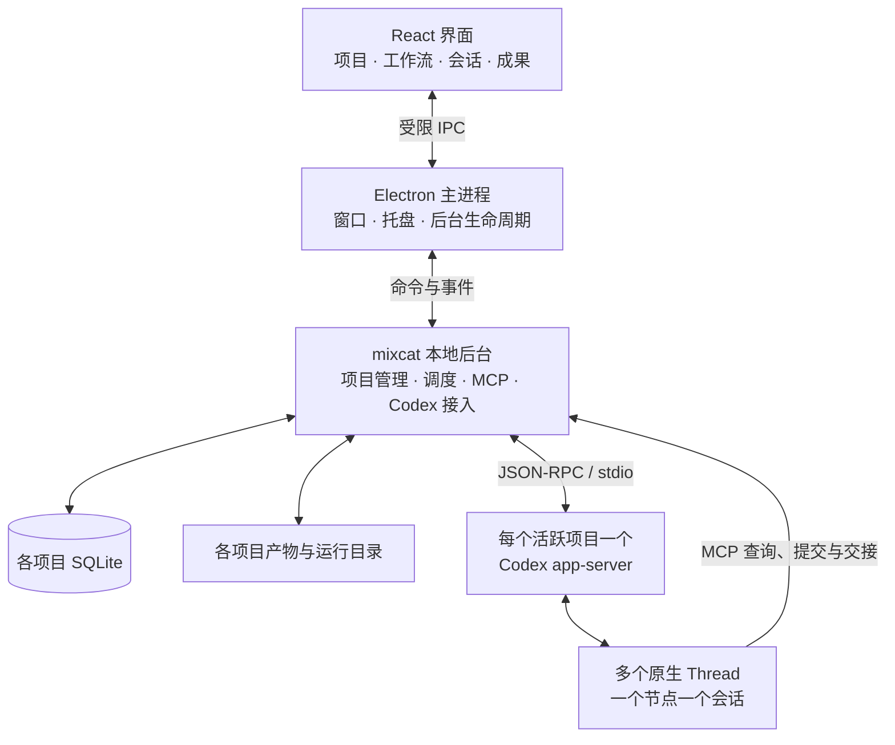

# mixcat 技术架构设计

归档目录：`docs/design/`。

日期：2026-10-19  
状态：初始技术方向及其决策依据的历史记录。当前功能与实现边界统一以 [客户端功能设计](2026-10-19-mixcat-client-functional-design.md) 为准，本文下方“当前建议”“首版”“待验证”是初始阶段记录。

配套历史文档：[项目工作流设计](2026-10-19-mixcat-workflow-design.md)。本文保留独立桌面、项目级原生进程、持久任务和 MCP 身份边界的设计来源，不替代现行功能说明。

文中历史实现进度保留验证原型的观察，原型归档见 [桌面原型](../../prototypes/desktop/README.md)。当前根目录正式实现和证据统一见 [交付矩阵](2026-10-20-delivery-status.md)，架构修正契约见 [可靠性与边界修订](2026-10-20-architecture-hardening.md)；八项任务及最终独立整体复核已通过。

## 现行实现对初始方案的更新

- Electron 主进程、受限 preload、React 界面、utility-process 业务后台、项目级 Codex app-server、本地 MCP 和 SQLite 已落地；实际依赖版本以项目清单为准。
- 普通会话没有固定输入或结果 Schema；节点可选择模型、技能和插件。Mixcat 不再强制只读和自动拒绝原生审批，审批由用户响应；工作流工具权限只管理 Mixcat 的协作入口。
- 同节点按序执行，不同节点可分别执行。它们共享所属项目目录；初稿“共享可写目录串行修改”没有成为全项目文件写入锁，当前不提供自动文件冲突解决或 worktree 合并。
- 原生历史由 Codex 保存，Mixcat 同时保存原始条目、输入来源和时间线，并能补读原生历史。项目 SQLite 当前数据结构、迁移和目录见统一功能设计及 README。
- 全部暂停/开启与单节点暂停/启用覆盖每个节点唯一的多值 `status`，项目状态仅汇总；暂停名单只确定恢复范围，不形成第二层锁。详见 [节点控制专项](2026-10-19-node-controls.md)。
- 条件边已能保存和编辑；MCP 新工具定义、条件选择与调用规范仍待讨论。自由会话与交接链不再使用旧 12 轮上限，遗留演练接口除外。
- 工作面板已有网页展示与项目文件/图片/PDF/HTML 预览；Agent 内嵌浏览器工具桥、MCP App UI 双向桥尚未实现。详见 [会话工作台专项](2026-10-19-session-workbench-design.md)。

下文的验证计划保留为最初检查清单，不代表本次文档整理重新运行了测试，也不能用旧的“尚未创建应用”描述当前进度。各阶段已记录的验证证据见 [文档目录](../README.md)。

## 1. 架构目标与当前范围

首版是一款独立桌面应用，管理本机项目，并通过 Codex 原生会话执行各节点任务。

架构需要支持：

- 项目卡片、可编辑工作流、原生会话面板和成果查看。
- 每个节点有自己的职责、MCP 工具能力、输入要求和结果契约。
- Agent 自主选择接收节点及交接内容，后台负责校验、记录和实际派发。
- 正式交接、回流、独立审查、进度展示、暂停与恢复。
- 界面生命周期与业务执行分离，运行记录不依赖页面一直打开。
- 所有工作树和工作数据保存在各自所属项目内，且不写入 C 盘。

采用模块化单体：业务模块有清楚边界，仍作为一款桌面软件部署。当前不引入分布式调度、独立消息中间件或微服务集群。

ComfyUI 暂不纳入范围；codex-console 仅是 Codex app-server 接入参考，不构成本架构的依赖。

## 2. 技术选型方向

| 部分 | 当前建议 | 理由与边界 |
| --- | --- | --- |
| 桌面容器 | Electron | 管理窗口、托盘和本地后台进程；接受其桌面运行时体积与资源开销，尚未做本项目测量 |
| 界面 | React + TypeScript + Vite | 统一开发项目卡片、会话面板和节点编辑界面 |
| 工作流画布 | React Flow | 复用节点拖动、选择、连接及自定义节点能力 |
| 业务后台 | TypeScript，运行在独立 utility process | 将调度、数据处理和 MCP 接入从渲染界面分离 |
| 数据库 | SQLite | 保存流程版本、任务队列、执行与交接记录；驱动按选定 Electron/Node 版本验证后确定 |
| 产物存储 | 项目内文件目录 + 数据库索引 | 保存确定版本的成果，数据库记录来源和关系 |
| Agent 执行 | Codex app-server | 复用原生会话、工具执行和历史能力；协议集中适配 |
| MCP | 官方 TypeScript SDK，使用本地 Streamable HTTP | 提供节点发现、结果提交和交接工具 |
| 数据契约 | JSON Schema + 后台运行时校验 | 表达不同节点的输入、结果和工具参数要求 |

Electron 官方提供带 Node.js 能力的 utility process；React Flow 支持自定义节点；MCP 提供官方 TypeScript SDK。[Electron 进程模型](https://www.electronjs.org/docs/latest/tutorial/process-model)、[React Flow 自定义节点](https://reactflow.dev/learn/customization/custom-nodes)、[MCP TypeScript SDK](https://github.com/modelcontextprotocol/typescript-sdk)

Tauri 是可行替代。如果采用 Rust 后台，需要维护 TypeScript/Rust 两套实现边界；如果额外携带 Node 后台，则增加运行组件。当前主要工作集中在协议接入、MCP 和调度，优先选择 Electron 以集中技术栈。若后续体积或资源指标成为主要约束，再基于测量重新评估；不宣称已经证明某种方案性能更好。

> 会话工作台扩展已按用户的新要求调整：原生会话可自由输入输出、按节点排队/跨节点执行、保留原始历史并接入审批和工作面板。旧版首发范围中的只读、固定结果格式和项目级串行约束不再适用于新会话界面。当前实现及宿主能力边界见 [会话工作台扩展设计](2026-10-19-session-workbench-design.md)。

## 3. 进程与通信结构



### 3.1 界面进程

React 界面显示项目和执行状态，并通过明确的业务命令操作后台。界面不直接访问数据库、启动 Codex 或执行任意系统命令。

通过 preload 暴露范围有限的接口，启用上下文隔离和渲染进程沙箱，不向界面提供通用 shell、任意文件读写或任意 IPC 转发能力。MCP 凭据和后台控制数据不交给界面持有。

项目状态以后台为准。界面重载时重新取得快照并订阅事件，不根据本地缓存自行恢复调度或重建任务。

### 3.2 Electron 主进程

负责窗口、托盘、操作系统交互及业务后台生命周期。业务规则不散落在窗口事件回调中。

主进程通过受限消息接口与 utility process 通信。utility process 是运行隔离边界，不应直接被解释成不可信代码的完整安全沙箱。

### 3.3 业务后台

首版使用一个业务后台进程管理多个项目。后台提供本地 MCP 入口；不同项目和节点通过独立认证上下文区分，不需要为每个节点独立部署一个 MCP 服务。

界面命令与 MCP 调用共享同一套业务处理逻辑，包括版本检查、权限判断、状态转换和持久记录。

### 3.4 Codex 进程

首选一个活跃项目一个 Codex app-server，项目内多个节点分别绑定独立 Thread。这个粒度便于项目数据、配置、生命周期和故障归属管理。

后台到 Codex 首选私有 stdio JSON-RPC 通道；Codex 到 mixcat MCP 使用本地 HTTP 通道。前者负责会话控制与事件，后者负责 Agent 主动查询和交接。

stdio 通道的恢复能力需要实测，不能假设后台重启后可重新附着到仍存活的旧管道。发生异常时先核对托管进程、会话和执行，再决定恢复或重启。

## 4. 后台模块边界

| 模块 | 职责 | 不承担的职责 |
| --- | --- | --- |
| 项目与运行管理 | 节点定义、流程版本、任务、交接、队列、暂停和恢复；唯一实际派发入口 | 不另建模型来替 Agent 重新选择每次路由 |
| Codex 接入 | 管理原生进程与连接，绑定 Thread，控制 Turn，处理原生事件 | 不定义业务验收结论 |
| MCP 入口 | 验证调用身份，提供节点工具清单，校验参数与结果，调用业务入口 | 不单独维护另一套工作流状态 |
| 项目存储 | SQLite 事务、产物版本、路径检查及文件操作 | 不复制一套原生会话执行引擎 |

这些模块是代码边界，不要求拆成独立服务或通用插件。先保持一套可追踪的调用链，后续出现实际需要时再拆分。

## 5. 原生会话与版本适配

后台保存以下对应关系：

```text
项目运行 → 节点 → Codex Thread
节点任务 → 执行记录 → 一个或多个 Codex Turn
```

节点再次收到返工任务时可继续原会话，但增加任务和执行记录。会话历史不替代流程状态；Turn 结束也不直接代表业务任务通过验收。

Codex 协议集中在接入模块中，固定经过验证的版本。主业务代码通过应用自身的命令和事件结构访问它，避免界面、MCP 与调度器各自解析不同版本的原生字段。

启动前检查所需接口能力；升级后重新验证会话恢复、节点配置、MCP 元数据和交接行为。当前上游源码中的能力不能自动视为目标二进制已支持。

## 6. 节点能力与结果契约

节点定义中包含以下概念字段，字段名称和完整格式仍可调整：

| 字段 | 作用 |
| --- | --- |
| `instructions` | 节点职责与工作要求 |
| `allowedTools` | 允许使用的 MCP 工具 |
| `inputSchema` | 接收任务需要的数据格式 |
| `resultSchema` | Agent 提交工作成果的数据格式 |
| `executionPolicy` | 文件、工具、并发和执行限制 |
| `revision` | 配置版本 |

一次执行开始前固定这份配置。后续修改生成新版本，不悄悄改变当前任务的职责、工具权限或验收标准。

共享协作工具可以包括项目查询、交接和结果提交；节点专属工具按能力配置开放。能够提交成果的节点不因此获得修改流程结构、扩展权限或批准整个项目的能力。

### 6.1 区分两种结果格式

- MCP 工具的 `outputSchema` 描述服务器返回给 Agent 的结果，例如查询内容或交接回执。
- 节点的 `resultSchema` 描述 Agent 应提交的成果，体现在提交工具的输入契约中，并由后台再次校验。

例如审查 Agent 提交“结论、问题、证据”，后台返回“已接收、结果编号、交接状态”。两者方向不同。MCP 结构化工具结果也不等于模型任务结果的语义正确性。[MCP Tools 规范](https://modelcontextprotocol.io/specification/2025-11-25/server/tools#structured-content)

首版采用普通配置对象和 JSON Schema 表达差异。具体节点工具清单、必填结果字段和验收规则留待业务契约设计，不提前建设动态插件装载系统。

## 7. MCP 接入与调用身份

### 7.1 已找到的源码依据

本次架构讨论查阅的当前 Codex 源码会在 MCP 调用中附加 Thread、调用标识和轮次相关元数据；官方 TUI 也存在通过 Thread 配置注入本地 MCP 服务及认证信息的实现。[MCP 调用元数据](https://github.com/openai/codex/blob/main/codex-rs/core/src/mcp_tool_call.rs)、[官方 TUI MCP 接入](https://github.com/openai/codex/blob/main/codex-rs/tui/src/dynamic_tools_mcp.rs)、[Thread 协议定义](https://github.com/openai/codex/blob/main/codex-rs/app-server-protocol/src/protocol/v2/thread.rs)

这些是 Codex 实现依据，不是标准 MCP 对任意客户端的身份保证；源码链接指向上游主分支，实施时需要固定版本并核对真实请求。

### 7.2 建议绑定方式

```text
节点专属 MCP 认证上下文
  → 项目、节点、运行及能力配置版本

Codex 提供的 Thread / Turn 元数据
  → 后台登记的原生会话和当前执行

工具调用标识 + 业务交接记录
  → 调用追踪、重复请求与冲突核对
```

为节点运行绑定分配受限、可撤销的认证上下文，并通过节点的受控 MCP 配置注入。后台从绑定关系确认来源，不相信模型在参数中自报的项目或节点身份。

工具清单根据认证上下文生成；实际 `tools/call` 再检查权限和当前执行状态。隐藏工具、客户端白名单和服务端授权是不同环节，不能相互替代。

不能假设一个 Thread 独占一条 MCP 连接，也不能直接把 MCP session ID 当作节点身份。工具发现时不一定已有活动 Turn，工具列表不能完全依赖调用阶段才出现的 Thread/Turn 元数据。

`callId` 可帮助关联调用，但不能未经验证就当作跨重试、跨恢复的持久业务幂等键；还需核对执行、交接标识及请求内容。

### 7.3 安全与子 Agent 边界

MCP 白名单控制不了 Agent 已经获得的任意 shell 或文件访问。随机凭据、回环监听及 Thread 元数据可以防止误调用和串线，但不自动构成同一操作系统用户下的强安全隔离。

后台状态和认证材料需要与节点可写范围分开，并通过目标平台的实际权限机制验证。项目内隐藏目录不等于权限边界。若要求抵御不可信代码或恶意节点，需要额外操作系统或沙箱隔离设计。

Codex 内部子 Agent 可用于节点内部工作，但不能仅因继承 MCP 配置就自动取得父节点的交接权限。未登记 Thread 的工作流写操作默认拒绝，继承规则后续明确。

## 8. 数据存储与界面同步

每个项目使用独立 SQLite 数据库。建议保存以下逻辑数据，实际表结构后续冻结：

| 数据 | 内容 |
| --- | --- |
| 流程版本 | 节点、职责、能力配置、结果契约及必要约束 |
| 项目运行 | 本次目标、采用版本、状态、任务链及限制 |
| 会话绑定 | 运行和节点与 Thread 的对应关系 |
| 任务 | 收件任务、输入引用、来源交接、排队状态 |
| 执行 | 处理尝试、派发状态、Turn 关联、结果与错误 |
| 交接 | 来源、接收方、任务、理由、成果版本和投递状态 |
| 产物索引 | 版本、实际位置、类型、来源及核验信息 |

数据库中的待派发任务承担队列作用，不再引入独立消息中间件。首版采用单个调度器领取任务，保持事务短小；可考虑 WAL，并按驱动和实际访问方式验证。SQLite 的并发读取与写入约束见[官方 WAL 文档](https://www.sqlite.org/wal.html)。

原生会话历史继续由 Codex 保存。mixcat 保存自己的业务事实、必要活动记录及原生记录引用，不把摘要当成原始事实，也不重复建设完整会话存储引擎。

流式文字与活动增量可直接推送界面，不必每个 token 都写一次数据库。任务接受、状态转换、成果登记等关键事实必须持久保存。界面恢复时先读取快照，再合并后续事件，避免将旧事件应用到新执行。

工作流布局、职责约束和实际交接历史分别存储。拖动画布位置不改变执行规则；历史连线表达已经发生的交接，不能被编辑操作改写。

## 9. 交接事务与执行恢复

### 9.1 正常交接

建议沿用工作流设计中的正式交接语义：

1. 固定并核验成果版本。
2. 在一个数据库事务中保存交接记录及等待来源完成的目标任务。
3. MCP 返回持久受理回执，不同步等待目标完成。
4. 来源执行结束且满足交付条件后，将目标任务转为可执行。
5. 调度器登记派发意图并占用目标节点，在事务外调用 Codex。
6. 收到明确响应后关联原生 Turn，开始追踪实际执行。

来源失败、中断、产物变更或结果不符合契约时，交接进入待核对状态。目标忙碌时任务排队，不默认打断或引导目标的当前任务。

不持有数据库事务等待模型推理、MCP 网络响应或工具执行。

文件系统与 SQLite 不共享同一事务。产物应先在项目内准备并固定，再登记正式引用；数据库提交失败产生的孤立文件需要可核对，不能先将尚不存在的文件登记为可交付成果。

### 9.2 派发结果未知

```text
已登记派发意图 → 正在发送 → 已确认接收 → 执行中
                         ↘ 结果待核对
```

本地事务可以保证登记和领取的一致性，不能单独保证外部 `turn/start` 恰好执行一次。

请求超时、断线或后台崩溃后，若不能证明原生服务未接收，就保留“结果待核对”。恢复时读取对应会话，可靠关联已经启动的 Turn 后继续追踪；无法确认时暂停该节点的后续派发，不直接重发。

JSON-RPC 请求 ID 或提示词中的任务编号不能未经验证就当作原生服务的持久幂等保证。锁或租约过期也不代表原生任务已停止。

### 9.3 回流和完成

Agent 自主选择返工接收方，后台记录新的任务或执行。反馈关联被检查的成果版本，保留之前的成果和审查依据。

回流次数及用量按任务链累计；更换节点不能重置限制。项目结束依赖明确验收条件，不能从所有会话暂时空闲推断完成。

## 10. 并发与桌面生命周期

### 10.1 并发

- 同一节点顺序处理任务，不同时启动两个活动任务。
- 不同节点可在统一并发上限下运行。
- 独立会话不等于独立文件；同一可写工作目录首版串行修改。
- 审查读取固定成果版本，可以与不冲突的任务并行。
- 真正并行修改代码需使用所属项目内的隔离 worktree，并定义成果汇合方式；首版不承诺自动合并。

### 10.2 生命周期

| 情况 | 预期行为 |
| --- | --- |
| 关闭窗口，应用仍在托盘 | 后台继续运行；重新打开时恢复显示 |
| 仅重载界面 | 重新读取后台状态，不重新创建任务 |
| 明确退出整个应用 | 停止新派发，处理活动执行，保存待恢复或待核对状态后退出 |
| 应用崩溃或系统重启 | 不保证任务继续运行；下次启动先核对进程、Thread、Turn 和产物 |

首版不安装系统服务。应用整体退出后，不承诺后台任务仍持续执行。

恢复时不能只凭 PID 认领或终止进程，需要核对应用记录及进程身份。原生任务和子工具是否仍存活、能否重新接入，需要在目标系统上验证。

## 11. 项目内数据布局

各受管项目的数据建议存放在自己的根目录中：

```text
<项目根>/.mixcat/
  state/        数据库及 WAL/SHM 等事务文件
  codex/        本项目 Codex 数据与配置
  artifacts/    确定版本的成果
  runtime/      实例、执行与恢复记录
  logs/
  tmp/
  cache/
  worktrees/
```

mixcat 自身开发数据保存在 `G:\code\mixcat` 内；受管项目数据不集中复制到 mixcat 源码目录。桌面壳自身缓存和工作台索引也需明确归属并设置合规目录。

创建前验证绝对路径和已有祖先目录的真实位置，不能通过符号链接、目录联接或路径跳转写到项目外。项目位于 C 盘、工具不能重定向工作数据或实际路径越界时，停止相关写入并说明。

Electron 缓存与日志、Codex 数据、系统临时变量及子工具缓存均需逐项配置和核验，不能沿用 AppData、系统 TEMP 或全局 worktree 的默认位置。写入重定向的完整性属于验收内容，目前尚未验证。

## 12. 实施前的关键验证

先验证三个会直接影响进程粒度和 MCP 方案的问题，再冻结详细接口与依赖版本。

| 验证 | 需要证明的结果 |
| --- | --- |
| 节点差异 | 同一 app-server 内两个 Thread 使用不同 MCP 工具清单和结果契约；并发、缓存、配置变化及恢复后仍正确 |
| 调用身份 | 真实 MCP 请求可关联已登记节点及活动执行；未知 Thread、旧执行或失效认证不能提交工作流变更 |
| 交接恢复 | 在来源结束前和目标启动请求发出后分别中断应用；恢复后能核对状态，不误推进或盲目重复派发 |

同时覆盖以下约束：

- 工具调用和交接重复请求不会登记重复有效任务。
- 工具返回格式与 Agent 任务结果格式分别校验。
- 来源失败、中断或成果版本变化时阻止错误投递。
- 窗口关闭、明确退出和进程崩溃具有不同且可验证的行为。
- 子 Agent 不因继承配置意外获得父节点调度权限。
- 节点工具范围与文件权限符合实际执行策略。
- 全部工作数据留在所属项目根内，且不写入 C 盘。

若目标 Codex 版本无法稳定支持节点级配置，可重新评估每节点一个 app-server 等接入粒度；不能将增加进程数量当成强安全隔离。调整接入方式时保持项目、任务、交接和产物模型稳定。

这些是待执行的技术验证，不是本轮已通过的测试。

## 13. 暂缓事项与证据边界

当前暂缓：系统服务、分布式调度、独立消息中间件、插件市场、复杂嵌套流程、并行写成果自动合并，以及 ComfyUI 接入。

首版数据库驱动、依赖版本、实际节点工具清单、完整结果 schema、身份凭据生命周期及流程版本切换细节尚未冻结。Codex 登录与配置在项目内数据目录中的实际行为也需要接入验证。

本次架构讨论已查阅官方文档和部分当前公开源码，未创建应用、安装依赖、运行 Codex/MCP 集成探针或测量桌面性能。当前可确认的是方案具有接口和源码依据；运行正确性、兼容性和隔离效果仍需通过上述验证。
