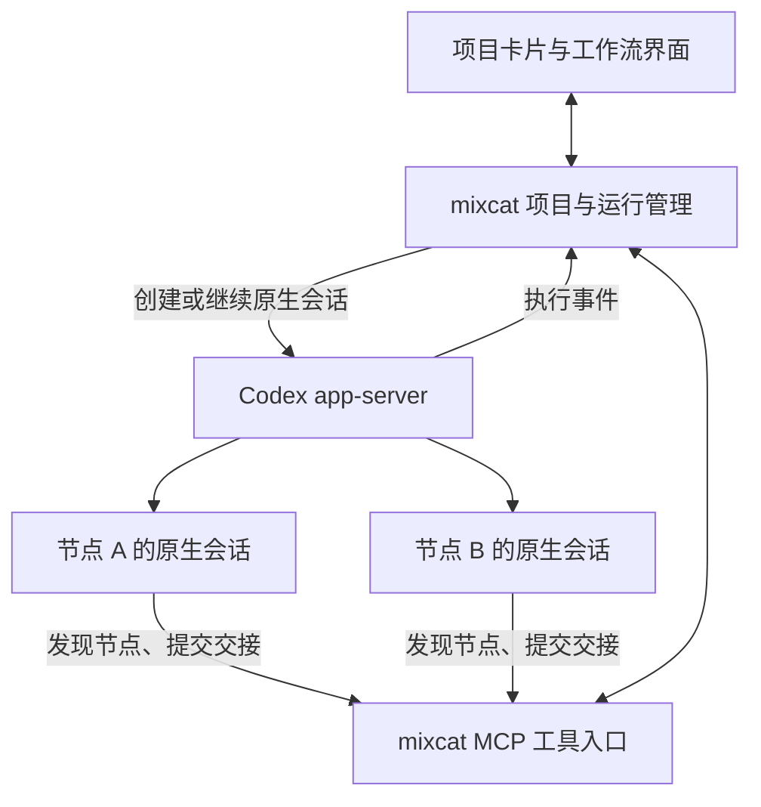

# mixcat：由 Codex 会话与 MCP 驱动的项目工作流设计

归档目录：`docs/design/`。

日期：2026-10-19  
状态：初始工作流方案的历史记录。后续会话工作台和节点控制已扩展并替代部分行为，当前功能统一以 [客户端功能设计](2026-10-19-mixcat-client-functional-design.md) 为准。

配套历史文档：[技术架构设计](2026-10-19-mixcat-technical-architecture.md)，记录最初独立桌面形态、技术选型、进程与存储边界。本文以下“首版”“建议”“待验证”均指初始方案阶段，不代表当前功能仍未实现。

当前正式开发版实现与验证统一见 [交付矩阵](2026-10-20-delivery-status.md)；八项任务及最终独立整体复核已通过，本文历史路线不作为生产硬编码要求。

## 现行规则与历史适用范围

| 本文原始假设 | 当前规则 |
| --- | --- |
| 节点职责约束输入和结果契约 | 用户可向任意节点自由输入，普通回复无必填业务字段；遗留 MCP 契约仅用于兼容原工作流，新的工具与调用规范另行讨论 |
| 暂停推进与中断工作是不同入口 | 四个现行操作为全部暂停、全部开启、暂停节点、启用节点，覆盖各节点唯一的多值状态；暂停请求原生中断，开启在原会话续接 |
| 回流次数按任务链限制 | 新界面的自由会话与交接链没有原先的 12 次业务上限；仅遗留 `start` 演练接口保留保护 |
| 输入输出要求与协作约束共同决定路径 | 关联边和自然语言条件可编辑、持久化；条件目前不执行，也未定义新的 MCP 条件选择语义 |
| 会话历史与画布展示为方向建议 | 已有节点原生上下文、输入右侧/输出左侧、来源标注、项目时间线和部分工作面板；不等于已继承所有官方桌面宿主能力 |

Agent 自主选接收者、后台确认来源成功再释放交接、保留历史与异常不盲目重发等原则仍适用。当前暂停细节见 [节点状态与暂停覆盖](2026-10-19-node-controls.md)，能力及面板边界见 [会话工作台专项设计](2026-10-19-session-workbench-design.md)。下文保留原始设计，不应据此恢复已经移除的能力或消息格式限制。

## 1. 目标与范围

mixcat 面向 OPC 工作台，以项目为入口，把多个 Codex 原生会话组织成可查看、可编辑、可回流的工作流。本文按 OPC 指一人公司工作场景理解。

用户已明确的要求：

- 每个项目是一张卡片，进入后展示整理好的工作流。
- 每个工作节点都是一个 Codex 原生会话，节点输出可以成为其他节点的输入。
- 支持回流、工作进度、当前工作内容和对抗审查。
- 工作流支持人工编辑，也支持 Agent 自主建立。
- 使用 MCP 向 Codex 提供项目节点、职责等信息，使各 Agent 可以自主选择成果交接对象。
- 不同节点可以拥有不同的 MCP 工具能力和结果格式；本轮记录这一方向，具体契约后续细化。
- 先在 mixcat 内操作 Codex 会话，不要求与官方客户端互通。

当前范围只覆盖上述工作流核心。ComfyUI 暂不纳入设计；codex-console 仅是已有 Codex app-server 接入方式的参考，不作为本方案的产品或架构依赖。未来其他项目类型保留扩展方向，本轮不设计插件市场或通用扩展平台。

本文将用户明确要求与建议采用的运行机制分开描述。工具名称、字段和状态名称用于表达设计含义，尚不是冻结的 API 或数据库结构。

## 2. 核心方案

采用“Agent 自主选择交接对象，后台可靠执行并记录”的方式。

1. mixcat 保存项目身份、节点职责、任务、成果和运行记录；项目方向通过与用户持续沟通确认并可调整，不在创建时写入固定目标。
2. Codex 通过 mixcat MCP 查询当前项目及节点目录。
3. 每个 Agent 根据实际工作结果，自主选择接收节点、交接材料和下一步任务。
4. Agent 调用交接工具；后台检查身份、范围、输入和运行条件，持久保存交接记录。
5. 后台通过 Codex app-server 启动目标会话的新轮次，持续更新项目界面。

节点之间的具体路线不必全部预先写死。人工可以设置必要约束，例如某类成果交付前必须完成独立审查；Agent 在这些约束内自主选择下一步。

后台不需要再调用另一个模型，为每次交接重新作一次语义路由判断。它负责验证和执行 Agent 的选择；选择无法执行时，返回具体原因，由 Agent 调整或请求人工处理。



上述模块表达职责边界，首版可以位于同一个后台应用，不要求独立部署。

## 3. 概念与数据边界

| 概念 | 职责 |
| --- | --- |
| 项目 | 保存目标、资料、约束、所属工作目录及成果入口 |
| 工作流定义 | 保存节点、职责、输入输出要求和必要的交接约束，并具有版本 |
| 节点 | 表示一项持续职责，以原生会话作为主要操作界面 |
| 原生会话 | 保存该节点的交流和工作历史，由 Codex 管理 |
| 工作流运行 | 记录本次项目推进使用的流程版本、任务链及总体状态 |
| 节点任务 | 节点本次收到的具体工作要求，可能来自用户或其他节点 |
| 节点执行 | 记录一次任务处理尝试、实际输入、对应原生轮次及结果 |
| 产物 | 可交接的文本、文件、代码成果、报告等具体结果及其版本 |
| 交接记录 | 记录来源、接收方、任务、产物版本、选择理由和投递状态 |

在一次工作流运行中，一个节点绑定一个 Codex 原生会话。节点再次接到返工任务时，可以继续原会话，但新增任务或执行记录，保留既有结果。一次节点执行可能包含多个原生 Turn；不能把一次回复结束直接视为业务任务完成。

节点标识与 Thread ID 分开保存。节点不因原生会话轮次增加而改变身份。整条流程重跑时，如何选择新会话、继续旧会话或从历史分支，后续明确策略。

会话历史、工作流状态、产物和模型结论各自保留。摘要用于帮助理解，不覆盖原始资料、用户确认的内容、成果和验证证据。

## 4. 节点职责与能力

每个节点至少需要描述：

- 节点标识、名称和职责。
- 适合接收的任务，以及完成任务所需的输入。
- 应交付的结果和验收要求。
- 可访问的工作范围、工具能力及执行限制。
- 当前是否可用，以及与本次交接有关的状态。

示例节点仅用于说明，不要求每个项目采用同一组角色：

| 节点 | 职责 | 典型结果 |
| --- | --- | --- |
| 需求 | 澄清目标、约束与验收条件 | 需求说明、待决问题 |
| 实现 | 根据任务完成成果或修改 | 成果版本、变更说明、验证记录 |
| 验证 | 执行检查，核对实际行为 | 检查证据、失败步骤、未测范围 |
| 审查 | 独立评判成果与要求是否一致 | 结论、问题、证据、争议 |

不同节点支持的 MCP 工具和结果可以不同。共享的协作入口不意味着所有节点获得相同业务工具、结构修改权或最终验收权。节点目录需要表达这些差异，让交接方判断接收者是否适合处理任务。

首版保持通用的来源、任务、版本和交接元数据；具体结果内容按节点职责定义。暂不确定每种角色的工具清单、结果 schema、能力发现协议或工具配置方式。

任务和行为要求可通过指令传达。目录、工具访问、预算及结构修改等硬边界需要由后台和执行环境落实，不能只依赖提示词。

## 5. MCP 协作入口

建议先围绕以下四类能力设计工具。名称为示例，是否拆分及各节点的可见范围后续确定。

| 建议工具 | 作用 | 主要内容 |
| --- | --- | --- |
| `get_project_context` | 了解项目和当前任务，发现协作者 | 项目目标、本人职责、节点目录、输入要求、相关成果与交接状态 |
| `handoff` | 提交成果并选择下一接收者 | 目标节点、下一步任务、成果引用、选择理由 |
| `complete_task` | 提交当前任务完成或需人工处理的结论 | 结果引用、依据、未解决问题 |
| `update_workflow` | 自主建立或调整流程结构 | 节点及职责变更、必要约束、所基于的定义版本 |

工具名称保持稳定，项目节点通过数据读取，不为每个节点动态创建一套同名职责工具。

`complete_task` 提交的是 Agent 的结论。后台仍需核对结果和执行状态；单个节点结束不自动代表项目通过验收。执行节点、审查节点及项目最终完成的判定权需要在任务和项目规则中明确。

`update_workflow` 只对具备相应能力的节点开放。普通执行节点可以在获准范围内自主选接收方，不必同时具备修改所有职责、验收规则或权限的能力。

### 5.1 调用身份

项目、来源节点和当前执行身份必须由接入层建立绑定并由服务端校验，不能信任模型自行填写的 `from_node_id`。

不能假设标准 MCP 请求天然携带可信的 Codex Thread ID。采用会话级连接、受限执行凭据还是其他绑定方式，需要结合实际 Codex 接入能力验证。这是实现前必须解决的接口问题。

### 5.2 交接示例

实现节点可以提出以下交接：

```json
{
  "to_node_id": "verification",
  "task": "验证登录功能，重点检查失败提示和输入保留行为",
  "artifacts": ["login-change@v2", "implementation-notes@v2"],
  "reason": "实现已完成，需要实际运行验证"
}
```

示例中的产物引用表示后台已登记、可解析的成果版本。准确参数结构、引用生成方式和重复请求标识尚待细化。

## 6. 输出交接与自主选路

### 6.1 交接内容

一次交接包含：

- 接收者需要处理的明确任务。
- 具体成果及其确定版本。
- 必要说明和验证证据。
- 未完成、未验证和仍有争议的内容。
- 项目原始要求中与本次任务有关的关键约束。
- 后台记录的来源节点、任务及执行信息。

目标会话的新一轮输入由“目标节点自身职责 + 项目要求 + 本次交接内容”组成。小型文本和结构化结果可以直接传递；较大成果通过可访问的文件或产物引用提供，必要时再追溯完整原始资料。

文件路径本身不构成稳定的成果版本。需通过不可变副本、可重建的代码版本等方式固定成果；内容摘要用于核验是否改变，不能单独保证旧内容仍然可取。接收者必须能实际读取交付物。

### 6.2 自主选择接收方

Agent 根据项目节点目录和工作结果，自主决定：

1. 哪个节点最适合接手。
2. 交接哪些材料。
3. 希望对方完成什么任务。
4. 为什么选择这一步。

例如实现节点可以选择先验证，也可以在需求冲突时交回需求节点。审查节点发现问题可以返回实现节点；证据不足时可转交验证节点。具体路径不要求预先枚举。

后台检查目标是否存在、是否属于可交接范围、输入是否满足要求、成果是否可读，以及项目必经验收要求是否仍被满足。交接被拒绝时返回原因，不静默改投其他节点。

Agent 未找到合适节点时，可以请求人工处理；具备建流能力的 Agent 也可以通过受控入口修改节点结构后继续。

### 6.3 正式交接与投递

建议首版把 `handoff` 作为当前任务的正式交接动作：

1. Agent 提交交接意图和确定的成果。
2. 后台持久保存交接记录，返回交接编号和受理状态。
3. 来源 Agent 结束当前轮次；工具调用本身不会自动结束原生轮次。
4. 后台核对来源轮次、交付物和任务状态，满足交接条件后投递。
5. 目标空闲时启动新一轮；目标忙碌时先进入持久任务队列。

若来源轮次失败或被中断，待投递交接进入待核对状态，不能自动把未就绪的结果交给下游。来源迟迟未结束时也不能把“已受理”显示成“已执行”。

`handoff` 持久登记后及时返回，不在同一次 MCP 调用内等待目标 Agent 完成。这样 A 交给 B、B 再返工给 A 时，不会因工具调用一直占用 A 而相互等待。

默认不把新交接任务作为引导消息塞进目标正在执行的任务。每个节点同时处理一个活动任务，首版按顺序消费收件任务。中途咨询、同步等待以及流式交付暂不纳入首版语义。

## 7. 运行控制、回流与恢复

### 7.1 控制入口

用户操作、Agent MCP 调用和后台调度使用同一套状态检查与记录机制。同一批工作流节点只有一个实际派发入口，避免主 Agent 和程序各自独立启动同一任务。

节点内部可以使用 Codex 原生子 Agent 完成局部工作，但不因此绕过项目节点的交接记录。子 Agent 是否继承节点的交接能力及如何识别来源，后续细化。

后台通过原生 Thread/Turn 接口创建、恢复、启动、引导或中断工作，并通过原生事件更新状态。工作流生命周期独立于浏览器页面，关闭界面不丢失已登记任务。

### 7.2 区分几类状态

| 层级 | 示例 | 含义 |
| --- | --- | --- |
| 原生轮次 | 运行中、完成、失败、中断 | Codex 执行情况 |
| 节点任务 | 等待输入、待执行、运行、待核验、待人工处理、完成、失败 | 当前业务工作推进情况 |
| 交接记录 | 已受理、等待来源、等待目标、已投递、待核对、投递失败 | 材料是否已经交给下一节点 |
| 项目 | 进行中、等待处理、满足交付条件 | 整体目标和验收情况 |

上述名称用于说明，不是最终状态枚举。原生 Turn 完成、交接已受理和业务验收通过是不同事实。

“暂停流程推进”与“中断当前工作”分开：前者允许当前工作结束但停止后续派发；后者请求中断活动轮次，确认中断后再更新状态。继续工作前需核对已有成果，中断不会自动撤销文件或其他已发生的操作。

### 7.3 回流

回流表示携带新反馈开始下一次处理，不清空历史，不回滚代码，也不覆盖旧成果。反馈必须对应被检查的具体版本。

工具暂时失败后的重试与审查不通过后的返工分别记录。回流次数或用量按同一任务链累计，不能通过更换节点、创建新执行记录来重置限制。达到限制或无法收敛时进入人工处理出口。

### 7.4 恢复约束

- 一个节点同一时刻只有一个活动任务处理者。
- 事件必须关联正确的运行、节点执行和原生轮次；旧事件不能结束新任务。
- 重复交接请求需核对并复用既有交接记录，不重复派发。
- 启动请求超时或断线后先核对目标是否已经接收，不能直接重发。
- 重启后从持久记录恢复，并与原生会话实际状态对账。
- 任务投递与完成记录必须可追溯；不宣称外部操作天然具备“恰好执行一次”的保证。

## 8. 对抗审查

执行与审查使用独立会话。审查节点依据目标、验收要求、成果版本和实际证据作判断；不同会话本身不保证判断正确。

审查问题应包括位置或对象、影响、依据和验证方式。执行节点可以修复，也可以用证据提出异议。需要修改时，审查节点自主选择合适的返工接收者。

能够程序核验的条件由程序检查；需要判断的质量问题交给审查或人工。结构化输出仅约束结果格式，不等于语义正确。证据不足、反复争议或达到任务链限制时请求人工处理。

保留被审查版本、问题、修复及复查的对应关系。单个 Agent 调用完成工具不自动绕过项目要求的审查或最终验收。

## 9. 工作流编辑与界面

### 9.1 定义与实际路径

编辑视图展示节点、职责、能力、输入输出要求和必要约束。运行视图展示实际交接路线、原因、成果版本及回流次数。

“允许怎样协作”与“这次实际怎样协作”使用不同的数据含义。实际交接记录可投影为连线；用户编辑节点或约束时，不改写已经发生的历史。

同一项目可能形成不同路径，例如：

```text
需求 → 实现 → 验证 → 实现 → 验证 → 审查 → 完成
需求 → 实现 → 审查 → 需求澄清 → 实现 → 验证 → 审查
```

### 9.2 人工和 Agent 共用定义

人工编辑和 Agent 自主建流更新同一份工作流定义，记录版本。正在执行的任务使用已确定的职责、输入和成果要求；新定义在明确的执行边界生效。

修改不自动扩大运行权限或预算，也不把旧成果自动认定为满足新要求。涉及输入、验收要求或能力变化时，应标出受影响的任务和需要重新验证的结果。具体版本切换策略后续细化。

### 9.3 展示内容

- 项目卡片：目标、当前阶段、正在做的事情、最新成果、需要用户处理的事项。
- 工作流画布：节点状态、实际交接路线、等待位置及回流次数。
- 节点详情：原生会话、本次任务、输入、结果和执行历史。
- 活动记录：真实消息、工具调用、命令、文件变更和验证信息。
- 交接详情：谁交给谁、为什么、交了哪一版成果、是否已被处理。

进度优先显示可信状态与已完成交付项。只有总量可知时才显示可解释的比例；模型生成的活动摘要不冒充精确完成率，也不覆盖原始执行记录。

## 10. 数据位置

项目工作树和工作数据保存在所属项目根目录内，不能写入 C 盘或项目外，也不能通过符号链接、目录联接等方式跳出项目。

工作数据包括会话相关工作数据、产物、运行记录、辅助脚本、日志、缓存、测试数据及备份。实现时需检查 Codex 和其他工具的可配置数据位置；无法满足约束时停止相关写入并说明，不回退到默认全局目录。

凭据不写入设计文档、交接正文或公开成果。工作目录和存储布局的具体配置留待实施设计。

## 11. 首版验证闭环

建议用一个实际任务验证以下完整过程：

1. 创建项目卡片及若干职责明确的节点，能够人工编辑。
2. Agent 通过 MCP 获取节点目录，并在获准范围内建立或调整流程。
3. 执行节点完成成果，自主选择验证或审查节点并提交交接。
4. 接收节点获得正确任务、原始约束与具体成果版本。
5. 验证或审查发现问题，自主交回适合修改的节点，形成一次可追溯回流。
6. 用户能查看进度、当前活动和每次交接依据，也能暂停推进或中断工作。
7. 通过明确验收条件结束；不能用全部会话暂时空闲来推断完成。

必要的异常验收：

- 目标忙碌时任务排队，原任务不被意外改变。
- 重复工具调用、迟到事件和断线未知结果不会导致错误派发。
- 来源失败、产物不可访问或版本发生变化时不错误推进。
- 应用重启后能核对并恢复工作流状态。
- 回流达到限制时停止继续派发，并给出可处理的原因。
- 不同节点的工具范围和结果要求能被表达，且不被其他节点绕过。

以上是后续实现的验收目标，本轮未执行这些验证。

## 12. 待细化事项与当前非目标

| 待细化事项 | 当前边界 |
| --- | --- |
| 节点专属 MCP 工具与结果 | 已确认允许不同；暂不定义角色工具清单和完整 schema |
| 调用身份绑定 | 必须服务端校验；具体接入机制需要验证 |
| 正式交接的提交协议 | 已明确异步受理、核对就绪再派发；事务、去重和恢复机制待设计 |
| 原生接入版本 | 以实际部署版本验证 MCP、会话、事件和控制能力 |
| 流程中途修改 | 必须有版本边界；影响范围和切换方式待细化 |
| 重跑与上下文策略 | 区分继续、重试、返工及全流程重跑；会话复用策略待明确 |
| 多节点并行与汇合 | 本轮以单次交接、单节点顺序处理为基础；分发和汇合后续设计 |
| 子 Agent 的身份与能力 | 可以用于节点内部工作；继承规则和交接权限待明确 |
| 最终验收权限 | 按项目要求定义；不得把节点自报完成直接视为项目通过 |

当前不展开 ComfyUI、官方客户端互通、插件市场、复杂嵌套流程、分布式调度和跨机器产物传输。数据库、前端框架及 MCP 传输部署方式的建议另见配套技术架构设计；具体版本与实现仍待验证。

## 13. 技术依据与验证边界

本次讨论核对了以下官方资料，用于确认可复用的接入能力：

- [Codex App Server](https://developers.openai.com/codex/app-server/)：原生会话、轮次、执行事件、Review 和 Goal 等控制能力。
- [Codex MCP](https://developers.openai.com/codex/mcp/)：接入自定义 MCP 工具和服务说明的能力。
- [Codex Subagents](https://learn.chatgpt.com/docs/agent-configuration/subagents)：节点内部可复用的原生 Agent 协作能力。

截至本设计日期，讨论中查阅的公开接口未发现可直接托管本文完整工作流模型的原生工作流资源。本文的节点目录、交接记录、业务状态及恢复规则属于 mixcat 的设计，不宣称是 Codex 已有功能。

尚未连接目标 Codex 后端运行真实工作流，也未验证 MCP 调用身份绑定、异常恢复或节点能力隔离。文档仅沉淀当前设计；后续实现方案需要结合实际版本和接口验证结果制定。
