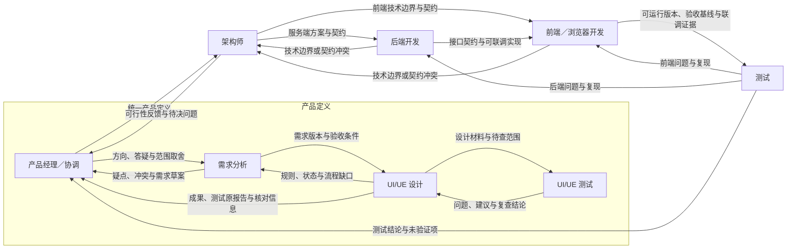

# Web 产品团队与产品定义域工作流

2026-10-27 修订：新模板为八个独立会话，增加 UI/UE 测试，并将产品经理、需求分析、UI/UE 设计和 UI/UE 测试组织为“产品定义”分组。产品经理协调并统一交给架构师；职责、条件边和核对依赖与[产品定义域设计](2026-10-27-product-definition-domain.md)一致。此前六个真实会话的产品验收是历史证据，不能据此声称新增角色已完成真实模型产品验收。

日期：2026-10-22。状态：作为首个 Web 产品模板的设计基线。设计落档、实现进度和实际验收分别记录；本文不以方案确认代替真实会话、工具和产品验证。

本文补充 [客户端功能设计](2026-10-19-mixcat-client-functional-design.md) 和 [MCP 协作设计](2026-10-21-mcp-collaboration-design.md)。消息、授权、版本、暂停和恢复沿用已有契约；具体实现和验证范围以 [当前交付与验收矩阵](2026-10-20-delivery-status.md) 为准。

2026-10-29 修订：项目创建不再填写固定目标。模板文档与共享计划仅标记方向待与用户沟通确认且可后续调整，不复制创建描述作为已确认业务约束；已有用户文档仍按后续沟通维护，不批量覆盖。

## 1. 目标与决策范围

首个模板面向有前后端、在浏览器中使用的 Web MVP，让独立 Codex 会话共同完成需求、设计、开发、测试和产品验收。第一轮建议围绕一条核心用户流程交付可运行版本，再逐步增加范围；这不是输入、功能数量或节点能力的硬限制。

### 1.1 已明确的要求

- 八类节点为产品经理、需求分析、UI/UE 设计、UI/UE 测试、前端／浏览器开发、后端开发、实现阶段测试和独立架构师。
- 产品定义分组包含产品经理、需求分析、UI/UE 设计和 UI/UE 测试；产品经理是协调节点与统一交付出口。
- 前端、后端、测试的能力组合增加 Ponytail 与 GitNexus。
- 节点通过 Mixcat MCP 沟通，项目文档保存持续维护的需求、设计、计划和验证结果。
- 使用 planning-with-files 保存任务工作记忆，结合 Superpowers 的相应阶段技能组织工作。
- 每个节点保留独立会话和上下文历史，cwd 使用所属项目目录；用户可以向任意节点自由输入。
- 能力配置用于增加或激活能力，保留 Codex 原生能力。角色分工与文档责任不是文件权限或原生工具白名单。
- 正式设计放在 `docs/design/`，实施计划放在 `docs/plans/`；不建立以工具或技能名称命名的正式设计目录。

### 1.2 建议默认值

当前模板为八节点：产品经理兼任项目协调，汇总产品定义交给架构师；架构师独立负责技术方案与接口契约，后端负责服务端实现，前端组织联调。分组没有独立会话、运行状态或自动汇合调度器。本文中的职责、默认技能、交接条件及文档划分都可以按项目调整，不成为通用引擎的固定角色或隐藏审批条件。

### 1.3 首版组合

| 问题 | 默认方案 |
| --- | --- |
| 谁协调任务与依赖 | 产品经理兼任；产品定义由产品经理统一交付架构，其他协作按实际条件边流转 |
| 谁负责架构与接口 | 架构师维护方案和唯一契约，前后端提供实现反馈 |
| 如何传递任务与反馈 | Mixcat MCP 显式发送、关联回复；每条出边生成绑定目标的工具，条件与描述指导选择 |
| 如何保留工作成果 | 正式文档记录需求、设计、接口与测试依据，MCP 消息说明任务、变化和成果位置 |
| 如何保留执行进度 | planning-with-files 跟踪所选计划；一个共享计划有一个维护者 |
| 如何组织工作方法 | Superpowers 按阶段使用，ECC 按职责使用；前端、后端、测试增加 Ponytail 与 GitNexus |
| 如何判断是否可交付 | 测试报告实际验证结果，产品经理核对业务目标；不增加通用的隐藏审查门槛 |

## 2. 节点职责与完成依据

| 节点 | 主要责任 | 当前工作可以交接的依据 |
| --- | --- | --- |
| 产品经理，兼协调 | 明确目标、用户、范围和优先级；与需求分析反复澄清，协调分歧；汇总产品定义并组织业务验收 | 本轮产品说明、需求、设计、独立测试原报告、问题处理与人工决定能定位，版本对应且未决事项明确 |
| 需求分析 | 整理流程、规则、状态、异常和验收条件；疑点与取舍返回产品经理 | 相关需求可以用于设计，关键问题有结论；不确定内容明确标注 |
| UI/UE 设计 | 页面、交互、视觉和状态；向需求分析反馈缺口，处理测试问题并提交人工核对 | 设计对应需求，测试原结论和核对信息可定位；成果返回产品经理 |
| UI/UE 测试 | 独立检查需求覆盖、流程、状态、交互、可用性和可访问性；问题与复查结论交回设计 | 每项问题有位置、依据、影响、观察和复查结果；区分静态检查、原型验证及未验证范围 |
| 前端／浏览器开发 | 页面和交互实现、浏览器调试、接口接入；牵头联调并提供可运行版本 | 说明实现范围、启动方式、依赖、实际验证和源码版本；联调阻塞可复现 |
| 架构师 | 技术栈、模块边界、数据与权限方案、接口契约、运行部署及关键技术取舍 | 方案与契约具备明确版本，前后端可据此实施；变更说明影响与依据 |
| 后端开发 | 依据架构方案与接口契约实现服务端业务、数据处理、权限、迁移及验证 | 实现与契约一致，接口具备联调条件；提供运行方式、错误响应和实际证据 |
| 测试 | 从验收条件独立准备测试，执行实际功能与回归验证，记录缺陷和证据 | 逐项给出实际结果、复现步骤和未验证项，结论对应明确的源码与环境 |

产品经理负责产品目标、范围和本轮统一产品定义；技术方案与接口契约由独立架构师维护，前后端提供反馈并实现各自模块。需求与验收条件随成果流转，实现阶段测试收到集成后的可运行版本再独立验证。设计测试结论不能替代用户人工决定或真实产品验收。产品经理汇总进度时依据交接记录、执行结果和验证证据，不凭一句自然语言“完成了”修改运行状态。

## 3. 主流程与回流



架构师在相关开发任务开始前形成可实施的方案：确定技术栈、模块边界、数据模型、接口契约、认证方式、运行／部署方式和文件责任。小型 MVP 可以用一份技术说明与一份接口契约承载，不为每项选择增加独立文档。

产品经理与需求分析按具体问题反复澄清，不规定讨论轮数。产品方向通过后，设计与设计测试可以修正、复查并产生 UI/UE 核对材料；架构、前端和后端执行须等待产品方向及 UI/UE 两项当前版本的核对。架构师收到统一成果后形成技术方案，并把相关需求、设计和契约交给前后端。多方输入的就绪判断由实际负责节点完成。

### 3.1 建议条件边

| 来源 → 目标 | 自然语言条件与交接重点 |
| --- | --- |
| 产品经理 → 需求分析 | 开始细化需求、回应问题或调整范围；附目标、约束、决定与本轮变更 |
| 需求分析 → 产品经理 | 需要取舍、发现冲突或提交需求草案；明确待回答问题 |
| 需求分析 → UI/UE 设计 | 本轮需求可用于设计；附版本、验收条件、已处理问题与非阻塞项 |
| UI/UE 设计 → 需求分析 | 发现规则、状态或流程缺口；附场景、依据与影响 |
| UI/UE 设计 → UI/UE 测试 | 初次送测或修正复查；附需求与设计版本、真实材料与待查范围 |
| UI/UE 测试 → UI/UE 设计 | 返回缺陷、建议或复查结论；关联送测原消息与内部 Issue |
| UI/UE 设计 → 产品经理 | 成果、测试原结论与核对信息；准确说明等待核对与未决事项 |
| 产品经理 → 架构师 | 本轮完整产品定义；附明确版本、原始测试报告、核对记录与架构问题 |
| 架构师 → 产品经理 | 可行性问题、冲突或产品决策；由产品经理组织组内下一轮 |
| 架构师 → 后端／前端 | 对应模块的方案与契约已可实施，附版本、任务边界及验证要求；分别投递 |
| 后端／前端 → 架构师 | 实现发现技术边界或契约冲突，附影响与证据，需要澄清或修订方案 |
| 后端 → 前端 | 相关接口可联调，说明契约版本、运行条件和未完成部分 |
| 前端 → 测试 | 目标用户流程可以运行，附源码版本、环境、启动步骤和验证记录 |
| 测试 → 前端／后端 | 找到具体实现问题，附期望、实际结果、复现步骤与证据 |
| 测试 → 产品经理 | 本轮验收条件已有逐项结果，可以进行业务验收；需求或交互缺口交产品经理决策，必要时重新进入下一轮需求 |

条件边按[动态条件边 MCP](2026-10-24-dynamic-edge-mcp.md)生成来源节点可见的工具。Agent 根据条件与描述判断是否适用，调用后直接沿绑定目标投递；需要新的联系时显式编辑工作流。需要多方参与时分别调用对应工具，不能将单目标发送理解成广播。

默认模板共十八条条件边。产品定义只由产品经理向架构师交付，需求不直接交架构、设计不直接交前端；实现阶段继续由前端向测试提交集成版本。新模板不会自动覆盖已有项目，已有项目通过明确编辑分组及实际连线采用此流程。路由工具随出边变化；其他工具授权、skill、插件及原生能力继续按节点配置管理。

### 3.2 验收与审查

本模板建议由独立测试会话验证核心用户流程，再交产品经理核对业务目标。实现问题沿当前条件边回流给前端或后端；需求、交互及范围缺口随测试结论交产品经理决策，再进入下一轮需求。

沿用两个业务人工核对点：产品经理提交产品需求方向，设计、设计测试、架构、前端和后端等待该核对；设计提交 UI/UE 方案，架构、前端和后端等待该核对，且该核对依赖产品方向。材料产出节点不会等待自己负责产出的核对先通过。

UI/UE 核对附独立测试的原报告，并引用已通过的产品方向版本。发送成功表示受理，未通过时接收任务保存为 `waiting_review`；核对决定返回提交节点原会话，再沿条件边同步。材料变化沿用陈旧检查与新版本核对，旧决定不能批准后来变化的内容。分组不增加隐藏审批、自动语义检查或自动汇合。

## 4. MCP 沟通与成果交接

协作能力沿用已有投递和历史机制，发送工具按条件边动态生成，不另起一套文档通信协议：

| 工具 | 模板中的用途 |
| --- | --- |
| `get_project_context` | 查询目标、自身任务、其他节点职责、条件边和当前状态；需要选择模型／技能／插件时按现有参数查询真实能力目录 |
| `edge_<hash>` | 每条出边动态生成对应工具，按其条件与描述选择，向绑定目标传递任务、成果、通知或显式回复 |
| `get_delivery` | 查询某次发送的受理与接收任务状态、尝试和关联回复 |
| `read_history` | 按节点、任务或消息关联读取原始协作记录，避免仅凭摘要判断 |
| `request_review`、`get_review` | 责任节点提交具体版本并查询用户决定；材料与原始决定保留关联 |
| `update_workflow` | 在已获授权时创建／调整节点与条件边，支持自主组织协作 |

产品经理建议承担模板组织与工作流维护责任；其他节点可以按实际授权编辑工作流。职责归属不替代已有工具授权，也不限制节点的原生能力。

### 4.1 发送和回复的含义

- 条件边工具受理成功表示已保存并进入绑定目标的输入队列，不表示目标已经开始或成功。
- 普通发送不结束来源当前 Turn。来源可继续独立工作；需要等待答复时正常结束本轮，回复在原 Thread 中排队续接。
- 目标忙碌时排队，暂停时保留；发送不隐式启用目标，也不抢占当前任务。
- 人工核对约束接收任务的执行，不禁止投递已准备好的成果。沿当前条件边正常发送，未通过的接收任务由引擎保存为 `waiting_review`，通过后再执行；不能把等待核对误解为不交接，否则普通空闲节点不会仅因其他节点的核对通过而自动续行。
- 回复使用 `reply_to` 关联原消息。普通会话输出不会自动发给其他节点，不需要为每条回复自动再发一轮“收到”。
- `reply_to` 只表示原接收节点回复原发送节点。转交第三个节点是新消息，在正文引用前序消息编号；不把整条工作流的共同来源误写成直接回复，也不自动创建反向边。
- 按现有 `request_id` 契约处理重试；同一编号不能改成另一份内容。
- `complete_task` 按原有配置提供；旧交接记录及内部恢复保留，`handoff`／`send_message` 不再作为任意目标的公开入口。

来源节点、会话和任务身份由 Mixcat 关联。用户输入与节点输入分别记录，接收节点显示真实来源；输入在右、输出在左，项目历史按已有稳定时间顺序汇集原始记录。文档摘要不替代这些历史。

### 4.2 交接内容

正文可以是自然语言或任意合法业务 JSON。以下是建议包含的信息，不是新增必填业务 Schema：

1. 希望对方完成什么，以及希望得到何种回复。
2. 对应需求、设计、接口、源码或成果的位置与版本。
3. 实际完成和验证了什么，仍有哪些假设、限制或阻塞。
4. 相关验收条件，以及需要关联的原消息。

保存文档不会自动通知或启动其他节点。需要协作时，负责节点在保存相关成果后显式通过 MCP 发送。

一次完整的文档协作按以下顺序推进：先阅读当前版本，维护者更新自己负责的文档，再发送变更说明和成果引用；接收者读取收到的版本，完成工作后关联原消息回复结果。发现规则或接口不一致时先说明差异，请原维护者确认更新，再通知受影响的节点。MCP 保存协作关系，文件保存持续维护的成果，两者通过消息与版本关联。

### 4.3 版本与附件

需要固定本次交接内容时使用现有附件项，让宿主在受理时创建快照并记录哈希。正文中仅写一个文件路径，不会自动固定该文件版本。后续修改文档或代码，应使用新消息说明变化，不静默替换旧交接的成果。

测试和审查结论应关联实际收到的消息、附件及实际使用的源码。已提交的 Git 版本可以用于定位；包含未提交改动时还需说明或固定相应文件版本，不能仅凭 HEAD 声称整个工作区已冻结。固定附件不等于整个项目的原子快照。`work_context` 关联本轮 Todo、Issue 与文档，`observed` 只保留版本观察；固定交付需附原始需求、设计、独立测试报告和真实资源的附件快照。多文件原型按资源清单附齐，无法固定或操作的材料说明限制。产品经理汇总时保留原报告及核对编号，不能以自己的摘要替换独立测试结论。

### 4.4 示例：后端交给前端联调

后端先保存接口契约、运行说明与实际验证记录，再交给前端汇合。正文可以写为：

> 订单创建接口已可联调。请按照附件中的接口契约接入结算页面，处理库存不足的错误展示。支付回调尚未完成，本轮只验证订单创建与错误状态。完成后请关联本消息回复联调结果和阻塞项。

前端使用收到的版本联调，完成后将可运行流程与需求验收基线交给测试。测试发现接口问题时沿条件边交回后端；涉及业务规则或交互方案变化时交产品经理决策。消息只能沿当前实际存在的边流转，不能假定关联回复会自动创建反向边。

## 5. 项目文档与维护责任

| 内容 | 建议位置 | 主要维护者 |
| --- | --- | --- |
| 产品目标、MVP 范围与优先级 | `docs/design/product-brief.md` | 产品经理 |
| 流程、规则、状态与验收条件 | `docs/design/requirements.md` | 需求分析 |
| 页面、交互、视觉与组件规则 | `docs/design/ui-ux.md` | UI/UE |
| 设计问题、静态／原型检查与复查证据 | `docs/reports/<iteration>/ui-ue-test-report.md` | UI/UE 测试 |
| 模块、数据、认证、运行和部署方案 | `docs/design/architecture.md` | 架构师；前后端提供实现反馈 |
| 接口契约 | 项目现有共享类型或 OpenAPI 等权威文件 | 架构师维护唯一契约，前后端与测试提供反馈 |
| 详细实施任务与验证步骤 | `docs/plans/<iteration>-implementation.md` | 产品经理组织，开发节点补充自己负责的任务 |
| 执行证据、缺陷与测试结论 | 项目内报告目录，例如 `docs/reports/<iteration>/` | 各责任节点；测试维护最终测试报告 |
| 活动任务工作记忆 | 选定的 `.planning/<plan-id>/` | 该计划的明确负责人 |

这些路径用于目标产品项目；新模板初始化本轮文档，已有内容不会被初始化重试覆盖。小型 MVP 可以合并内容；接口描述复用现有契约，不维护互相冲突的多份定义。按需使用一个父 Todo 组织本轮产品定义，子 Todo 表示需求、设计、设计测试与汇总；收到消息、结束 Turn 或核对通过均不会自动完成 Todo，完成说明需指向交付消息和证据。

一份共享文档有明确的主要维护者。其他节点通过 MCP 提出修改、附理由和建议内容；责任节点确认后更新并通知受影响方。职责是协作约定，用户可以直接修改或重新分配。共享文件写入前应重读，保留用户及其他节点新增的内容；当前不宣称具备自动文件锁、自动合并或冲突解决。

文件责任同样适用于代码：前后端优先维护各自模块，共享契约、依赖清单、锁文件和构建配置由实际任务明确归属，避免同时覆盖。所有节点仍以项目目录为 cwd，不默认改成节点专属工作目录。

## 6. planning-with-files 的组织方式

### 6.1 共享计划与独立任务

`task_plan.md` 保存目标、阶段、依赖、决策和下一步；`findings.md` 保存调查发现、约束和依据；`progress.md` 保存实际操作、验证结果、问题与处理过程。

产品经理维护迭代总计划和汇总记录。执行节点维护自己负责的产出与任务记录，通过 MCP 报告进展，不同时改写三份共享计划文件。只有独立且复杂的任务才再建立独立计划，避免八个节点各自复制一套相同的需求和总计划。

```text
docs/
  design/                         # 产品与技术方案
  plans/mvp-001-implementation.md  # 唯一详细实施计划
  reports/mvp-001/                 # 实际验证与缺陷证据
.planning/
  mvp-001/                        # 产品经理维护的迭代总记录
    task_plan.md
    findings.md
    progress.md
  mvp-001-frontend-checkout/       # 一项独立复杂任务
    task_plan.md
    findings.md
    progress.md
```

Superpowers 的详细实施计划与 `task_plan.md` 分工不同：前者写清具体改动、任务接口和验证步骤；后者引用该计划并跟踪阶段与下一步，不抄写第二份详细任务清单。

### 6.2 会话与计划绑定

每次恢复复杂任务先明确项目和 `PLAN_ID`，只读取该任务的计划。多个计划并存时，不能用“最近修改的计划”代替会话身份，不能用共享 `.active_plan` 给并发会话选择不同任务。

`PWF_PLAN_ROOT` 指定实际项目根，`PLAN_ID` 选择其中的任务目录；需要由实际宿主在适当的执行边界绑定。在工具子进程中设置环境变量不会反向修改已经启动的宿主。若多个原生 Thread 共享一个进程，也不能假定同一进程环境可以同时表达各自的不同 `PLAN_ID`。

因此，每节点／每任务自动规划上下文的绑定仍属于 Mixcat 接入与验证事项。没有完成该绑定时，应显式在交接中给出计划路径，由责任节点读取，不能把文件存在或全局安装成功当作自动隔离已生效。

本模板的接入方案是按原生 Thread／session 身份保存计划绑定，由项目内适配器在每次 hook 调用时解析对应计划，仅为该次官方脚本调用设置 `PWF_PLAN_ROOT` 和 `PLAN_ID`。不切换共享 app-server 的进程环境，也不改写官方 handler 的职责。绑定应在开始 Turn 前准备好，恢复同一 Thread 时继续核对并复用。

初始 SessionStart 可能早于 Thread 身份回传。此时若没有可靠绑定，计划适配器应跳过计划注入并记录原因，不能猜测其他节点的计划。无效绑定、计划缺失和适配器失败应可见；确认旧绑定已清除或不可用后，相关节点可以显式读取已知计划路径，Codex 其他原生能力继续按宿主规则运行。如果无法安全更新或清除绑定，例如文件仍可读但被锁定或禁止替换，本次派发应在恢复 Thread 或开始 Turn 前停止并显示错误，避免沿用旧计划；不自动修复权限或变更信任。以上行为需要实际多会话验证，不能只用适配器单测作结论。

### 6.3 文件记录与运行状态

规划文件是工作记忆，不是第二套调度器。计划阶段的 `in_progress` 或 `complete` 不替代节点的真实运行、暂停或失败状态，也不替代原始会话历史。hooks 的提醒需要 Agent 根据实际工作填写，不能保证文档自动完整或语义正确。

## 7. skill、插件与 MCP 能力组合

| 节点 | 建议默认能力 | 按实际任务使用的补充能力 |
| --- | --- | --- |
| 产品经理 | `ecc:product-lens`；共享 planning-with-files 计划维护 | Superpowers 的目标梳理和实施计划组织；Mixcat 工作流编辑 |
| 需求分析 | `ecc:product-capability` | 需求不明确时梳理业务规则；与开发协同形成可验证约束 |
| UI/UE | `impeccable` | 依据实际设计任务选择交互、视觉或可访问性能力；存在真实设计工具需求时再接入 |
| UI/UE 测试 | 原生默认模型与现有工具；按真实目录选择技能和插件 | 静态设计检查；存在可操作原型时使用实际可用的浏览器和可访问性工具 |
| 前端／浏览器开发 | `ecc:frontend-patterns`、Ponytail `full`、GitNexus | 浏览器调试；Superpowers 的调试和完成前验证；对应技术栈的实现与测试技能 |
| 架构师 | `ecc:architecture-decision-records`、共享 planning-with-files | 技术方案、接口契约与变更影响；Superpowers 的方案梳理与计划 |
| 后端 | `ecc:backend-patterns`、Ponytail `full`、GitNexus | 接口／数据设计、迁移和安全等实际任务技能；Superpowers 调试与验证 |
| 测试 | `ecc:e2e-testing`、Ponytail `full`、GitNexus | Playwright Test、浏览器探索、缺陷定位和实际验证 |

前后端协作按需使用 `ecc:contract-first`，围绕同一份真实契约工作。模型从实际能力目录选择，保留原生默认选项；不在模板中写死虚构模型名称或未经验证的统一模型。

### 7.1 Ponytail

三个工程节点默认使用 `full` 原则：先理解调用方和影响范围，优先复用已有实现，完成能够解决任务的最小改动，并保留必要验证。

测试节点用它减少重复、脆弱或只照着实现写出的测试；验收范围仍由需求和用户流程决定，不能因此漏测核心行为、边界、数据损失或安全风险。

### 7.2 GitNexus

通过 MCP 提供代码查询能力，按需使用探索、调试、影响分析和重构技能。前端关注页面、组件、状态和接口关系；后端关注业务、数据和接口调用链；测试用变更影响补充回归范围并帮助定位缺陷。

项目复用一份明确归属的代码索引，建议后端牵头维护，前端与测试按需请求刷新。查询注明实际仓库、工作目录与索引版本，并检查未提交改动的覆盖情况。图谱缺失、过期、截断或零调用方都不能直接证明代码不受影响，仍需结合源码、文本搜索和真实测试。

### 7.3 浏览器与测试工具

首版建议前端和测试使用 Chrome DevTools MCP 做浏览器检查和问题探索，使用项目内的 Playwright Test 命令保存可复跑回归。是否增加其他浏览器 MCP 按实际缺口决定。

Agent 控制外部浏览器，与 Mixcat 节点工作面板中的内嵌浏览器，是需要分别接入和验证的能力。浏览器预览可用不代表控制桥已完成。并行节点需要区分浏览器会话、页面和测试数据；profile、截图、trace、缓存和下载文件保存在所属项目内。

### 7.4 能力接入原则

角色技能指导如何完成工作，MCP 提供可调用工具，插件承载其实际打包能力；只将宿主真实可发现的条目记为可选。全局已安装、节点已选择、原生请求已加载、工具实际调用成功和外部账号可用是不同的验证层级。

不把全部技能正文常驻注入每个节点，不把 Superpowers 整套编排在每个工作节点重复执行。已经确认的需求和设计直接引用；发现新问题或需要改变方案时回到实际责任节点。具体模型、技术栈和外部服务仍随目标产品确定。

## 8. 官方安装与 hooks 接入边界

2026-10-22 本机安装核对如下，是开发环境观察，不是其他机器或所有 Mixcat 节点的默认保证：

| 组件 | 本机安装观察 | Codex hooks 范围 |
| --- | --- | --- |
| Superpowers 6.4.2 | 官方 Codex 市场原生插件已安装并启用 | 当前 Codex 包未声明 hooks |
| ECC 2.2.3 | `ecc@ecc` 原生插件已安装并启用 | 当前 Codex 包提供 SessionStart；不等同于 Claude 的多档 hook profiles |
| planning-with-files 3.25.0 | 官方个人独立 skill 已更新，七类原生 hooks 已合并 | 隔离测试项目经用户明确批准后，七类真实生命周期、两个会话自动计划隔离与恢复已验证；其他项目仍需各自原生审核 |

planning-with-files 的七类 Codex hooks 为 SessionStart、UserPromptSubmit、PreToolUse、PermissionRequest、PostToolUse、PreCompact 和 Stop，分别用于恢复／补充计划上下文、提醒记录、压缩前保存提示和结束阶段检查。当前没有默认开启 gated 自动继续。

新增或变化的非托管 hooks 需要宿主按原生流程审核与信任；不直接伪造信任记录。官方独立配置与插件 hooks 是替代安装方式，不能叠加同一套定义造成重复执行。已有 GitNexus hooks 保留。

Mixcat 应展示原生查询返回的 hook 事件、来源、命令、启用状态与信任状态，供用户检查当前具体定义。用户明确确认后才通过宿主支持的原生配置接口提交对应版本的信任，再重新查询核验；普通能力配置、展开详情或 Agent 调用 MCP 不替代用户确认。定义变化后应重新审核，不能沿用旧版本的信任。

hooks 配置和信任须核对节点实际使用的 Codex 运行目录。当前独立 Mixcat 为项目运行准备 `.mixcat/codex/`；不能把官方桌面客户端或其他 Codex 运行目录中的信任状态直接当成该项目已经就绪。客户端应分别表达“已发现、已选择／准备、已加载、已信任、实际触发”，只有观察到实际生命周期事件及执行结果，才认定相应自动化已验证。

所有项目计划、缓存、下载、日志、浏览器数据、测试结果和工作树都留在所属项目内。全局 Codex skill／插件／MCP、必要运行依赖与内部配置按已有例外处理；不能把全局安装成功推广为项目工作数据可以写到项目外。

官方依据与本机证据：

- [Superpowers Codex 安装入口](https://github.com/obra/superpowers#codex-app)。
- [ECC Codex 原生配置流程](https://github.com/affaan-m/ECC/blob/main/skills/configure-ecc/SKILL.md)。
- [planning-with-files 固定版本 Codex 文档](https://github.com/OthmanAdi/planning-with-files/blob/de837a95cc845b6341a6cbfd902a89a8190c568e/docs/codex.md)。
- [本机安装与验证记录](../../.runtime/implementation/official-plugins-20261022-4d4a1df9/INSTALLATION.md)：该记录在本地忽略的运行目录中；65 个源文件核验、七类 hooks 的 12 次直接测试及原生技能发现，不等于 Mixcat 节点自动化验收。

## 9. 协调节点与独立架构师

当前由产品经理承担协调，独立架构师维护方案与契约，后端负责服务端实现。协调职责追踪负责人、依赖、进度和阻塞；架构职责解决跨模块方案、接口、数据与运行边界。两项职责都要形成明确任务和产出，避免被实现工作挤掉。

当多个功能并行、反复发生遗漏或重复工作、依赖阻塞长期无人处理，且产品经理已经难以兼顾产品决策时，再增加独立协调节点。该节点依据真实记录推进协作，不另建节点状态或控制锁，不要求所有消息经过它。

架构师是当前模板的独立角色。复杂权限、多租户、多系统接入、多服务、迁移与兼容性取舍由其统一记录；普通实现问题由对应开发节点解决，跨模块边界或契约变化才交回架构师。

架构师维护关键技术取舍和契约，不默认审批每个函数或重复执行测试。增加角色时重新明确文档和代码的维护责任，不保留两个相互冲突的权威方案。

## 10. 节点控制与异常协作

沿用 [节点状态与暂停覆盖](2026-10-19-node-controls.md)：每个节点各有一份多值权威状态，全部暂停、全部开启、暂停节点和启用节点直接覆盖它，不增加独立的项目暂停锁或节点暂停锁。

批量暂停记录当时运行范围；批量开启续接相应未完成工作，原先空闲的节点仍可保持待命，并在以后收到新交接时正常执行。单独启用可以覆盖批量暂停。本文的批量操作范围沿用现有项目内控制，不宣称已经提供跨全部项目的暂停入口。

协作等待不通过暂停来源节点实现。中断结果未知、已派发但结果不明的执行按既有待核对流程处理，不因计划还写着“进行中”就自动重跑。暂停无法撤销已经发生的工具或外部操作。

发现阻塞时，消息中说明缺少什么、已经尝试什么、需要谁提供何种输入。无法完成的验收或外部验证保留为未完成／未验证，不编造成功，也不把一轮会话正常结束当成整个项目已验收。

## 11. 后续落地与验收事项

以下是模板的实现验收标准，具体任务与进度记录在 [六节点模板实施计划](../plans/2026-10-22-web-product-team-implementation.md)；完成设计不代表这些项目已经通过：

1. 八个节点能创建并保存各自真实模型、技能、插件和独立 Thread；产品定义分组的四个成员与产品协调节点可持久恢复，cwd 与项目一致，原始历史可追溯。
2. 各节点的外部 MCP、浏览器、技能和插件在目标原生环境中确实可发现、加载和调用；保留 Codex 原生能力与原生审批。
3. 目标、职责、分组与条件能被查询，Agent 仅通过真实出边工具协作并关联合法回复；需求与产品反复澄清，设计与设计测试修正复查，架构反馈由产品经理组织下一轮。
4. 需求、设计、实现、测试的版本可以关联，文档更新通过显式消息通知；不假设广播、自动汇合或整个工作区冻结。
5. 共享计划有维护者，复杂任务明确绑定正确计划；多个会话不会因环境或选择器混淆而覆盖彼此记录。
6. hooks 在目标宿主已加载、按原生规则获得信任，并能在实际会话生命周期中触发；不以直接脚本测试替代此项。
7. 问题能回流给前端、后端、UI/UE 或需求负责人，测试结论对应真实版本，产品经理能依据证据进行业务验收。
8. 四种控制覆盖、暂停队列和未知执行恢复保持既有语义；核对前可受理并持久保存，相关任务等待当前产品方向及 UI/UE 决定，材料变化触发既有陈旧检查。

首轮流程验证可以选择一个只有“提交内容并显示服务端返回结果”的极小 Web 产品，覆盖需求、UI/UE、设计测试、前后端联调、浏览器操作、测试与业务验收。新增角色后的真实模型产品验证应保留八个真实会话、实际 MCP 发送与回复、文档和代码版本，以及浏览器访问后端的证据；受控 fixture 和直接运行 hook 脚本分别记录，不替代这轮实测，也不为演示回流故意制造缺陷。

暂不在本方案内扩展笔记／知识库服务、ComfyUI、额外团队平台、自动文件冲突解决或新的发布服务。目标产品的具体业务、技术栈、模型分配及外部账号接入在实际项目中确定。

### 既有项目的显式采用

新模板创建八个节点；打开旧项目缺少分组数据时按空分组读取，不自动套用模板。已有项目通过明确的分组、节点与连线编辑采用产品定义域，不依据节点名称猜测成员。分组编辑沿用原节点 ID、会话、历史、工作项、模型与能力选择；文档责任通过角色配置与明确交接更新。

旧项目显式扩展核对规则会递增其版本；原核对包与决定保留，不能冒充新版规则已通过，相关后续任务按当前规则等待重新核对。
