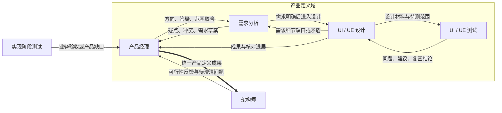

# 产品定义域与统一交付

2026-10-29 更新：本文的父/子 Todo 与内部 Issue 按[统一 Issue](2026-10-29-unified-issues.md)合并为可拆分、讨论和派发的 Issue；主工作关联使用 primary_issue_id，并兼容旧关联。

日期：2026-10-27。状态：用户已确认书面方案，并要求直接按 Ponytail 实现；对应 [Issue #44](https://github.com/shenmuegit/mixcat/issues/44)。实现与验收结果分别记录，不以方案确认代替运行证据。

代码核对基线：`aba878856e582f64fdddc8eb9194acfd502c4c07`。本稿基于当前项目管理、文档库、动态条件边和人工核对实现，替代此前只依靠文件路径组织成果的初步设想。

## 1. 已确认的目标与本稿默认值

用户希望把产品经理、需求分析、UI/UE 设计放进同一个框，形成一份统一成果交给架构师；认可由产品经理负责汇总与发出，并要求加入专门检查 UI/UE 设计的测试节点。需求分析与产品经理应反复讨论，逐步定义需求。

产品定义域因此包含四个独立 Codex 会话：产品经理、需求分析、UI/UE 设计、UI/UE 测试。它们使用同一个项目目录，分别保存上下文和历史。产品经理兼任域的协调节点与统一交付出口。

以下默认值随书面方案一并确认，区别于用户最初逐项提出的要求：

- 设计发现规则、状态或流程缺口时直接回需求分析；需求分析判断涉及目标、范围或优先级取舍时再交产品经理。
- UI/UE 测试将问题和复查结论交回设计节点，由设计节点修正并提交人工核对；产品经理汇总时保留独立测试的原始结论。
- 沿用当前两个业务人工核对点，增加架构师对 UI/UE 核对的依赖；不另设一轮分组人工审批。
- 设计测试根据实际交付材料工作。静态稿可以审查，存在可操作原型时进行相应操作验证；首版不强制每次设计都另建可运行应用。
- 首版采用单层分组，框内直接展示四个节点。分组边框根据成员位置计算，不增加独立运行状态或自动汇合调度器。

## 2. 方案选择

| 方案 | 收益与代价 | 结论 |
| --- | --- | --- |
| 仅增加视觉框 | 能看出节点属于同一阶段，但仍会分别向架构或前端发送零散成果 | 无法满足统一输出 |
| 现有产品经理协调、汇总后发送 | 复用独立会话、条件边、文件、工作项与人工核对；需要明确协调责任和回流条件 | 用户认可，采用 |
| 引擎自动收齐各节点结果并发送 | 可自动触发下游，但需要定义完成凭据、版本配对、并行轮次与返工后的汇合规则 | 本次不采用 |

新增能力集中在画布分组、模板职责与连线、核对依赖及交付约定。产品经理判断业务内容是否齐备；Mixcat 继续负责身份、保存、投递、队列与可追溯记录。

## 3. 当前实现与复用边界

| 当前能力 | 本方案用途与边界 |
| --- | --- |
| 每节点独立 Thread，公共项目 cwd | 四个角色各自续接上下文；分组不创建第五个会话 |
| 出边生成 `edge_` 工具 | 按真实连线讨论、反馈和交付；发送时不再解释自然语言条件 |
| Todo、Issue、Document 和 `work_context` | Todo 组织本轮工作；Issue 记录待决问题或设计缺陷；文档维护正式成果；交接关联相关对象 |
| 文档自动发现、版本及哈希 | 项目内 `docs/` 资料继续出现在已有文档库，受管写入沿用冲突处理 |
| 消息附件快照 | 固定本次交付的实际内容；`work_context.observed` 只有版本观察，不替代正文快照 |
| 人工核对包、材料陈旧检查、原会话续接 | 产品方向和 UI/UE 以用户对具体版本的决定为准 |
| 节点位置、连线布局、整理与快照更新 | 增加分组后仍需共同保存和正确呈现；现有平面布局目前不了解分组 |

当前 `ProjectState` 没有分组定义，Web 模板仍为七个节点，需求直接交架构、设计直接交前端。本方案增加一个 UI/UE 测试节点，形成八节点模板，并调整产品定义阶段的交接路线。

源码入口：[`model.ts`](../../src/core/model.ts)、[`web-product.ts`](../../src/core/web-product.ts)、[`project-items.ts`](../../src/core/project-items.ts)、[`project-items` 类型](../../src/shared/project-items.ts)、[`review-gate.ts`](../../src/shared/review-gate.ts)、[`Workbench.tsx`](../../src/renderer/Workbench.tsx)。

## 4. 节点责任与反复协作

| 节点 | 主要责任 | 本轮完成依据 |
| --- | --- | --- |
| 产品经理 | 明确目标、用户、范围、优先级与取舍；协调分歧；维护产品方向；汇总统一成果 | 方向与范围明确，需求及设计可相互对应，重要问题有处理结论，交付材料和用户决定能定位 |
| 需求分析 | 把方向细化为用户流程、业务规则、状态、边界和验收条件；主动暴露矛盾及未知项 | 相关需求足以支撑设计；影响后续设计的关键问题已有结论 |
| UI/UE 设计 | 信息结构、页面、交互、视觉与状态设计；处理测试反馈；提交 UI/UE 人工核对 | 设计对应明确需求，测试结论及问题处理可核实，相关版本已获人工核对 |
| UI/UE 测试 | 独立检查需求覆盖、流程、状态、交互一致性、可用性和可访问性 | 每项结论有依据；问题有具体位置、影响和复查结果；未验证的行为有说明 |

产品经理提出方向或回应取舍，需求分析提出疑点、冲突和需求草案，双方沿两条方向相反的条件边反复协作。结束条件依据内容是否明确，不规定固定讨论轮数。每轮围绕具体问题或文档变更推进；无法形成新依据的分歧交给产品经理协调，涉及用户决定的方向进入已有人工核对。

节点拥有的原生工具、模型、skills、插件和文件能力继续通过现有节点配置管理。文档维护责任用于协调协作，不转成角色权限白名单。新测试节点通过现有创建及能力选择方式配置，不凭职责名称宣称某个插件已经安装或启用。

## 5. 条件边与域边界

| 方向 | 条件与携带内容 |
| --- | --- |
| 产品经理 → 需求分析 | 开始细化需求、回应问题或调整范围；附目标、约束、决定及本轮变更 |
| 需求分析 → 产品经理 | 需要产品取舍、发现冲突，或提交需求草案供确认；明确需要回答的问题 |
| 需求分析 → UI/UE 设计 | 本轮需求可用于设计；附需求版本、验收条件、已处理问题和剩余非阻塞项 |
| UI/UE 设计 → 需求分析 | 设计发现具体规则、状态或流程缺口；附场景、现有依据及影响 |
| UI/UE 设计 → UI/UE 测试 | 初次送测或修正后复查；附需求与设计版本、真实材料和本轮待查内容 |
| UI/UE 测试 → UI/UE 设计 | 返回缺陷、建议或复查通过结论；关联原送测消息和相关 Issue |
| UI/UE 设计 → 产品经理 | 提交设计成果、测试原结论与人工核对信息；等待核对或存在未决问题时准确说明进展 |
| 产品经理 → 架构师 | 汇总本轮完整产品定义；附明确版本的材料、测试结论、核对记录及需要架构解决的问题 |
| 架构师 → 产品经理 | 统一成果存在可行性问题、冲突或需要产品决策；由产品经理组织组内下一轮处理 |
| 实现阶段测试 → 产品经理 | 沿用现有业务验收和需求／交互缺口反馈，继续从产品经理进入产品定义域 |

新模板移除需求分析 → 架构师、UI/UE 设计 → 前端这两条分散交付路线；架构师再依据统一成果向前后端传递任务及相关设计材料。其余开发、联调和实现阶段测试路线沿用当前模板。

统一出口通过上述模板连线表达。通用引擎不增加按角色名称判断目标的第二套路由规则。分组边框的外部连接显示实际产品经理条件边，边 ID、方向和来源节点仍可查看；不创建隐形转发节点或额外消息。用户以后显式修改边时，画布与动态工具应反映真实配置，不能用框把实际存在的跨域边隐藏掉。

## 6. UI/UE 测试与人工核对

UI/UE 测试检查设计材料与需求是否相符，以及流程、页面和交互表达是否完整。问题报告应提供位置、依据、影响、实际观察和复查方式；纯风格偏好作为建议。测试结论保存到已有报告文档，需追踪的缺陷使用现有内部 Issue，修正通过原有条件边送回复查。

当存在可操作原型时，测试可检查点击、返回、键盘、响应式及加载／错误反馈；只有静态设计时，结论必须限定为静态设计检查。UI/UE 测试不冒充接入真实后端后的产品验收，后续实现阶段测试继续依据实际产品行为验证。

确认采用的默认核对依赖如下：

| 核对点 | 提交责任 | 等待此核对的节点 | 上游核对 |
| --- | --- | --- | --- |
| 产品需求方向 | 产品经理 | UI/UE 设计、UI/UE 测试、架构师、前端、后端 | 无 |
| UI/UE 方案 | UI/UE 设计 | 架构师、前端、后端 | 产品需求方向 |

产品经理和需求分析可以在产品方向未通过时继续澄清；设计与设计测试可以在 UI/UE 未通过时修改、复查。避免把产生核对材料的节点锁在该材料自己的核对后面。

产品方向核对提交本轮产品说明和需求材料；UI/UE 核对在设计测试后提交设计材料及测试结论，并引用已通过的产品方向版本。测试报告由测试节点维护，设计节点提交原报告，不能将自己的判断替换成测试节点的结论。

沿用既有“先保存来信、派发时等待核对”的行为：消息可以在人工核对前排队，发送成功表示受理，不表示核对通过。产品经理可先整理成果；若已向架构师发送完整材料但用户尚未决定，架构任务进入 `waiting_review`。核对决定按既有机制回到提交节点的原会话，再沿条件边同步实际结果。

需求或设计材料变化后，沿用已有陈旧检查和新版本核对。旧决定保留其历史含义，不批准后来修改的内容；仅更新进度说明时使用单独进展记录，避免改动已经确认的材料正文。业务核对只采用项目明确配置的规则，分组不新增隐藏审查层。

## 7. 统一成果、工作项和版本

统一成果是产品经理发出的一次有明确版本的交付，内容可以包含多份材料，不要求固定业务 JSON。建议沿用以下责任与文件：

| 材料 | 主要维护者与现有位置 |
| --- | --- |
| 产品目标、范围和取舍 | 产品经理，`docs/design/product-brief.md` |
| 规则、流程和验收条件 | 需求分析，`docs/design/requirements.md` |
| 页面、交互、视觉和原型说明 | UI/UE 设计，`docs/design/ui-ux.md` 及其真实资源 |
| 设计问题与复查证据 | UI/UE 测试，`docs/reports/<本轮工作标识>/ui-ue-test-report.md`，引用内部 Issue |
| 交付说明 | 产品经理的原始 MCP 消息，引用以上材料、测试结论、核对编号和未决事项 |

复用一个父 Todo 表示本轮产品定义，其子 Todo 表示需求细化、设计、设计测试和最终汇总。项目中的工作项由用户或节点按需要创建，不在每次运行时重复生成。节点运行结束、收到消息或核对通过均不自动完成 Todo；完成说明应指向实际交付消息和证据。

讨论中的未决问题和设计缺陷使用现有 Issue 及评论。文档继续使用项目真实文件、自动发现、稳定 ID 和 `@` 引用；不增加文档页发送入口。用户通过现有 Todo 或节点输入发起工作，节点通过条件边协作。

交付消息以 `work_context` 关联本轮 Todo、Issue 和文档。需要固定的需求、设计、报告及资源通过已有附件快照发送，明确它们共同属于哪次交付；单有路径、当前文档引用、修订号或 Git HEAD 不能代表完整材料快照。多文件原型按实际资源清单附齐，无法固定或无法操作的材料在交付中说明限制。

产品经理检查采用的需求、设计、测试结论是否对应同一轮，并说明变化及未决事项。Mixcat 不新增发送后的内容审判或自动拼接摘要。已受理请求按原回执重放；资料后来更新，不重新解释已经发送的旧成果。下一轮交付使用新的消息并引用前一轮。

现有人工核对以项目检查点的当前版本为准。本版每个产品定义域围绕一条当前定义迭代；Todo 可划分工作，不能据此宣称已有多条相互独立、可并行批准的发布链。

## 8. 画布与最小数据变更

分组采用持久的成员关系与协调节点标识，建议记录稳定 ID、名称、成员节点 ID、协调节点 ID 和修订号；节点位置继续以现有项目画布坐标为准。协调节点必须属于分组，同一节点首版最多属于一个分组，不支持嵌套。

- 框内展示四个现有样式的节点卡片及真实内部条件边，标题为“产品定义”。点击成员仍打开它自己的会话与配置。
- 框的边界随成员位置与尺寸计算，并留出标题、连线标签和间距。移动成员不会自动改变成员关系，避免一次拖动意外改变工作流含义。
- 拖动分组标题整体平移成员，复用批量位置保存及即时预览；失败恢复已保存布局。组内连线随成员一起移动，外部连线跟随实际端点。
- 对外的产品经理连线可以在边框显示统一入口／出口，实际来源和目标继续为原节点；代理端点属于表现层，不能变成边与边相连。
- 整理按钮同时处理组内布局和组外位置。首版复用当前 ELK 与几何能力，先排组内，再把组的外接矩形参与整体布局，避免框内散落组外节点或标签重叠。具体调用组织由实施者决定。
- 分组显示成员实际运行概况。暂停和恢复继续操作节点的唯一状态，分组不增加另一层暂停锁或自动完成状态。
- 创建、编辑成员和协调节点、解除分组使用现有工作流编辑模式，提供菜单及键盘可达入口。解除分组只移除容器；删除协调节点前需先更换协调节点或解除分组，随后沿用既有节点删除约束。

`get_project_context` 可补充当前分组、成员与协调节点摘要，帮助 Agent 理解职责；通信目录仍完全来自节点实际出边。工作流编辑能力如需支持分组元数据，扩展现有 `update_workflow` 操作，不增加任意目标发送接口，也不自动给现有节点开启编辑能力。

首版不加入折叠、嵌套、多出口映射、额外聚合 Agent、自动结果汇合、分组专属消息队列或新运行状态机。

## 9. 既有项目与数据保护

已有项目缺少分组数据时按空分组读取，不依据节点名称猜测分组，不在启动时套用模板。先为新建 Web 模板提供上述八节点结构；已有项目通过明确的分组及连线编辑采用本方案，不提供自动覆盖整个旧图的迁移。

分组编辑保留实际节点身份、原生 Thread、会话历史、工作项、文档和用户已选能力。旧消息仍保留当时的边与资料快照。旧核对记录不自动转成新规则下的批准，核对规则变化按现有版本机制处理。

工作流或核对规则的编辑沿用当前运行时约束；新增动态工具在节点下一轮按现有目录刷新机制生效。仅移动或分组展示不能打断运行中的原生会话。

此前项目管理版本的一次性测试数据清空授权不适用于本功能，验证使用本次授权范围内的当前项目或项目内工作树，资料均保存在所属项目内。

## 10. 实施涉及的入口与验收依据

| 入口 | 应覆盖的变更及检查 |
| --- | --- |
| `src/shared/types.ts`、`src/core/model.ts`、`src/core/store.ts` | 分组元数据、缺省空分组、修订冲突、持久化与恢复 |
| `src/core/engine.ts`、`src/core/mcp.ts`、`src/shared/snapshots.ts` | 编辑命令、上下文摘要、完整／增量快照、成员删除约束及实际节点来源 |
| `src/core/web-product.ts` | 八节点模板、职责、组内回流、统一出口、架构回流、核对依赖与文档责任 |
| `src/renderer/Workbench.tsx`、`workflow-layout.ts`、`EditableEdge.tsx`、`edge-geometry.ts`、样式 | 容器、编辑、组移动、端点投影、整理与视口范围；键盘操作及失败回滚 |
| 既有项目管理、消息附件和人工核对 | 复用工作关联和固定材料；测试证明历史引用、陈旧检查、队列与恢复不被分组破坏 |
| 现有模板／工作流／动态 MCP／快照／布局及 Electron 测试 | 更新调用方和夹具，补充分组特有行为，避免仅凭静态类型判断交互通过 |

可测试的验收条件：

1. 新模板显示一个产品定义框、四个成员会话及独立架构／开发／实现测试节点；重启后成员关系和位置一致。
2. 产品经理与需求分析能够多轮往返，设计能把细节问题交需求分析；各条消息与原会话、Todo 和资料版本关联。
3. UI/UE 测试能指出具体缺陷，设计修正后复查；测试结论区分静态检查和实际操作，不混同人工批准。
4. 新模板仅通过产品经理向架构统一交付，没有需求直接交架构或设计直接交前端的工具；现有原生能力与用户选择不会因分组而减少。
5. 架构反馈回产品经理后能开启下一轮讨论；实现阶段测试原有产品反馈入口继续工作。
6. 方向未通过时设计／设计测试等相关任务等待；UI/UE 未通过时架构及实现相关任务等待，消息仍可持久受理；材料更新及重启不绕过核对。
7. 一次交付可同时引用当前管理对象并保留固定附件；文件随后修改，历史消息和旧核对包的原内容仍可定位。
8. 整组与单节点移动即时更新连线；整理后成员留在组内、节点和标签可辨认，组外节点不被框包入；保存失败恢复一致状态。
9. 编辑、解除分组和成员删除有明确结果；旧项目不自动改图、不重建会话、不重置测试数据。
10. 按项目规则创建或关联 enhancement Issue，完成必要测试、两轴代码审查、PR、合并，再构建和安全重启实际客户端。设计文档审阅不代替这些实现证据。

## 11. 设计边界与后续

这项改动包含分组表现及元数据、模板协作和核对依赖三个相连部分。现有项目管理和消息链路足以承载讨论与交付，无须建立另一套成果数据库。

主要取舍是架构开始正式工作前需要收到完整产品定义，技术可行性反馈可能较晚，因此保留架构 → 产品经理的明确回流。模型的业务判断和设计测试质量仍需真实案例验证，条件边可达性本身不能证明成果质量；首版不增加第二个语义审查器。

用户在审阅确认后要求直接实施，采用现有 Issue、测试与 PR 流程。具体组件拆分、操作命名和 ELK 组织方式交给实施者，用户可观察的协作方向、材料版本、人工核对与状态边界以本稿为准。

相关设计：[Web 产品团队](2026-10-22-web-product-team-workflow.md)、[动态条件边 MCP](2026-10-24-dynamic-edge-mcp.md)、[人工核对](2026-10-22-human-review-design.md)、[项目管理](2026-10-26-project-management-design.md)、[项目资料文档库](2026-10-27-document-library.md)。

## 12. 构建前审阅记录

2026-10-27，独立审阅 Agent 结合上述代码基线检查了核对依赖、待核对派发、工作关联与附件快照、动态条件边、文档库、分组端点及布局范围，结论为没有阻碍制定实施计划的重要未定决策。已检查本文与设计索引的本地链接、代码围栏和空白格式。该审阅评估方案能否进入规划，实际实现和运行验收仍按第 10 节执行。
